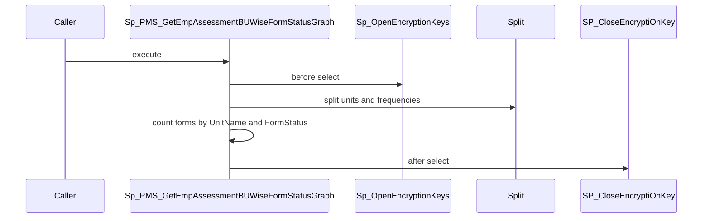
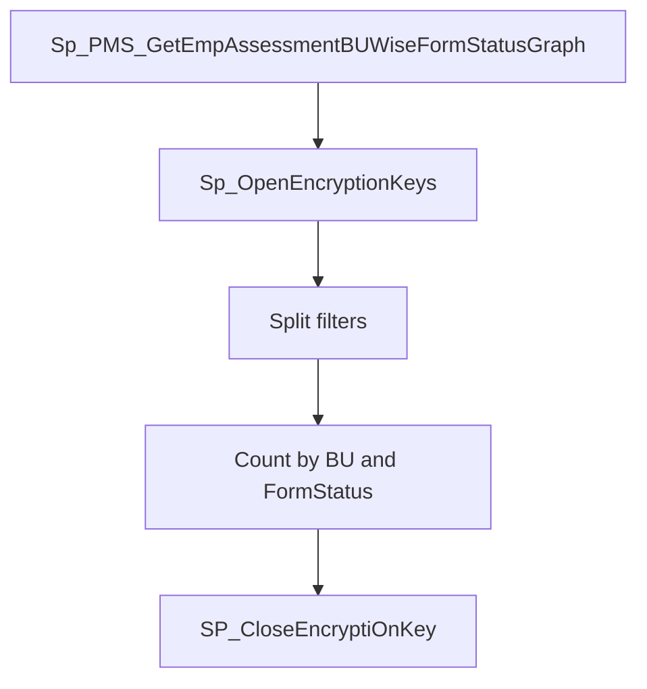

# Sp_PMS_GetEmpAssessmentBUWiseFormStatusGraph

## What it does

Counts assessment form statuses by employee business unit for the selected review frequencies. Used by the PMS Dashboard BU-wise form-status chart.

## Parameters

| Name | Direction | What it is for |
|---|---|---|
| `@EmployerID` | in | Employer filter on `TEmployeeInfo` |
| `@ReviewFrequencyId` | in | Comma-separated review frequency ids |
| `@OrganizationUnits` | in | Comma-separated unit ids, or `0` / null for all |

## Call sequence

## Callers

No other procedure or function calls this object. App caller: `performanceAssessmentDAL.GetEmpAssessmentBUWiseFormStatus`.

## Nested

| Object | Kind | When | Page |
|---|---|---|---|
| `Sp_OpenEncryptionKeys` | procedure | start | [Sp_OpenEncryptionKeys](/docs/database/hrms/Sp_OpenEncryptionKeys) |
| `Split` | function | CSV parameters | [Split](/docs/database/hrms/Split) |
| `SP_CloseEncryptiOnKey` | procedure | end | [SP_CloseEncryptiOnKey](/docs/database/hrms/SP_CloseEncryptiOnKey) |

## Steps

In `HRMS-DATABASE/HRMS/STOREPROCEDURE/Sp_PMS_GetEmpAssessmentBUWiseFormStatusGraph.sql`:

1. Execute `Sp_OpenEncryptionKeys`.
2. Normalise and split `@OrganizationUnits` and `@ReviewFrequencyId`.
3. Join `TPMSEmployeeSelfAppraisal` to cycle mapping, appraisal cycles, and `TEmployeeInfo`.
4. Group by assessment id, employer, business unit, and form status; resolve `UnitName` from `TOrgHierarchyDetails`.
5. Return counts with colour and sequence; execute `SP_CloseEncryptiOnKey`.

## Tables

| Table | Read or write |
|---|---|
| `dbo.TPMSEmployeeSelfAppraisal` | read |
| `dbo.TPMSEmployeeAppraisalCycleMapping` | read |
| `dbo.TPMSAppraisalCycles` | read |
| `dbo.TEmployeeInfo` | read |
| `dbo.TOrgHierarchyDetails` | read |

## Flow

