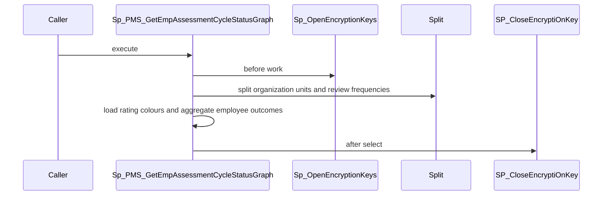
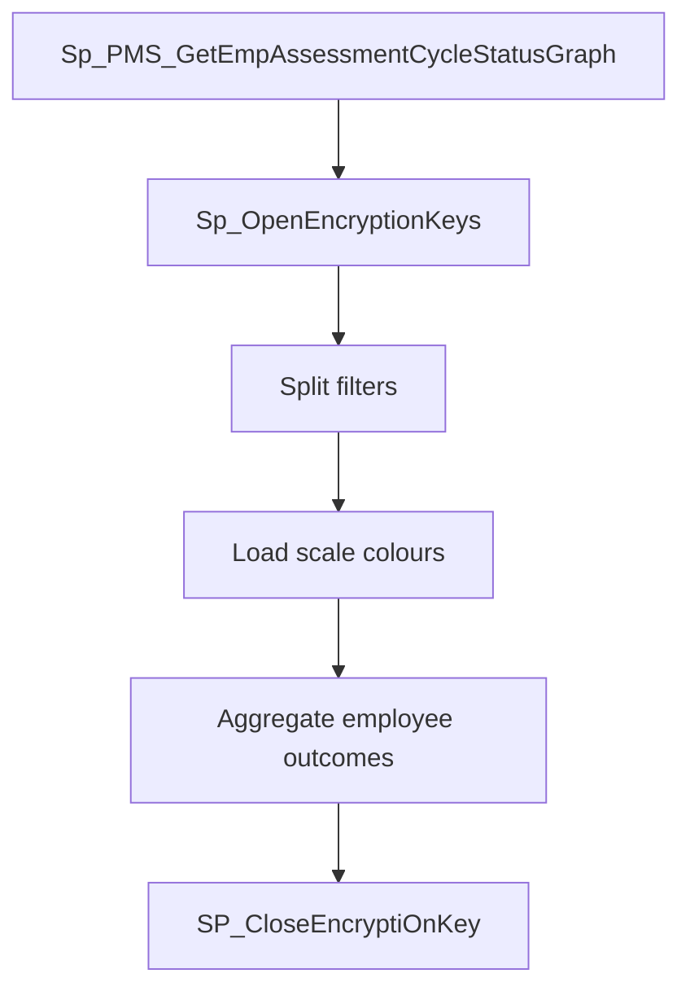

# Sp_PMS_GetEmpAssessmentCycleStatusGraph

## What it does

Builds the PMS Dashboard assessment-outcome series for one employer and selected review frequencies / business units. It resolves the cycle score method and rating scale colours, then aggregates employee final or normalised ratings into level descriptions with counts and colour codes.

## Parameters

| Name | Direction | What it is for |
|---|---|---|
| `@EmployerID` | in | Employer whose forms are counted |
| `@ReviewFrequencyId` | in | Comma-separated review frequency ids (default `0`) |
| `@OrganizationUnits` | in | Comma-separated business unit ids, or `0` / null for all |

## Call sequence

## Callers

No other procedure or function calls this object. App caller: `performanceAssessmentDAL.GetAssessmentCycleStatus` from PMS Dashboard.

## Nested

| Object | Kind | When | Page |
|---|---|---|---|
| `Sp_OpenEncryptionKeys` | procedure | start of body | [Sp_OpenEncryptionKeys](/docs/database/hrms/Sp_OpenEncryptionKeys) |
| `Split` | function | CSV organization units and review frequencies | [Split](/docs/database/hrms/Split) |
| `SP_CloseEncryptiOnKey` | procedure | end of body | [SP_CloseEncryptiOnKey](/docs/database/hrms/SP_CloseEncryptiOnKey) |

## Steps

In `HRMS-DATABASE/HRMS/STOREPROCEDURE/Sp_PMS_GetEmpAssessmentCycleStatusGraph.sql`:

1. Execute `Sp_OpenEncryptionKeys`.
2. Normalise `@OrganizationUnits` (`0` → null) and split units and review frequencies into table variables.
3. Read `IsEmployeeOverallComments` from `TPMSEmployerConfiguration` and score method / rating id from `TPMSAppraisalCycles` for the selected review frequency.
4. Load rating colour levels into a table variable from rating, weightage, or goal-category outcome details depending on score method.
5. Aggregate employee assessment outcomes from self-appraisal, cumulative rating, optional bell-curve normalisation, workflow, and employee info, filtered by employer, units, and frequencies.
6. Return series rows with colours; execute `SP_CloseEncryptiOnKey`.

## Tables

| Table | Read or write |
|---|---|
| `dbo.TPMSEmployerConfiguration` | read |
| `dbo.TPMSAppraisalCycles` | read |
| `dbo.TPMS_AppraisalReviewFrequency` | read |
| `dbo.TPMSRatingMaster` | read |
| `dbo.TPMSRatingScaleDetails` | read |
| `dbo.TPMSWeightageMaster` | read |
| `dbo.TPMSWeightageScaleDetails` | read |
| `dbo.TPMSGOALCATEGORY` | read |
| `dbo.TPMSGOALCATEGORYDETAILS` | read |
| `dbo.TPMSGOALCATEGORYOUTCOMEDEATILS` | read |
| `dbo.TPMSEmployeeSelfAppraisal` | read |
| `dbo.TPMSEmployeeAppraisalCycleMapping` | read |
| `dbo.TPMSAppraisalCumulativeRating` | read |
| `dbo.TPMSEmployeeAppraisalForBellCurve` | read |
| `dbo.TRequestWorkflows` | read |
| `dbo.TEmployeeInfo` | read |
| `dbo.TEmployee` | read |
| `dbo.TPMSCategoryMaster` | read |

## Flow

