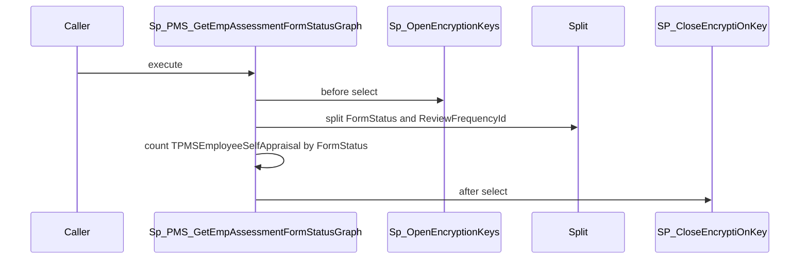
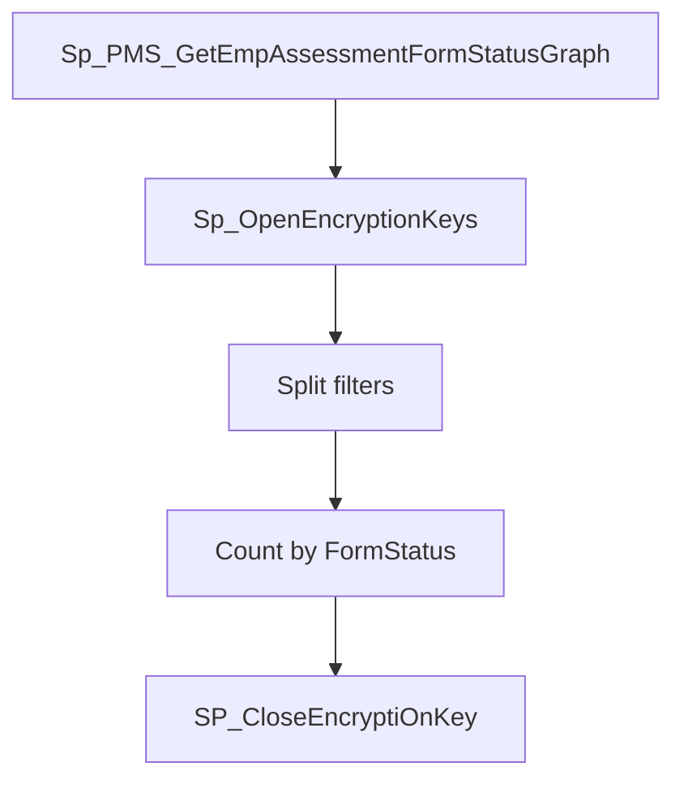

# Sp_PMS_GetEmpAssessmentFormStatusGraph

## What it does

Counts `TPMSEmployeeSelfAppraisal` rows by form status for the selected review-frequency ids, and attaches chart colours and sort order for the PMS Dashboard form-status tile.

## Parameters

| Name | Direction | What it is for |
|---|---|---|
| `@EmployerID` | in | Present on the signature; not used in the body filter |
| `@ReviewFrequencyId` | in | Comma-separated review frequency ids (default `0`) |
| `@FormStatus` | in | Comma-separated statuses, or `0` / null for all |

## Call sequence

## Callers

No other procedure or function calls this object. App caller: `performanceAssessmentDAL.GetEmpAssessmentFormStatusGraph`.

## Nested

| Object | Kind | When | Page |
|---|---|---|---|
| `Sp_OpenEncryptionKeys` | procedure | before the select | [Sp_OpenEncryptionKeys](/docs/database/hrms/Sp_OpenEncryptionKeys) |
| `Split` | function | split CSV parameters | [Split](/docs/database/hrms/Split) |
| `SP_CloseEncryptiOnKey` | procedure | after the select | [SP_CloseEncryptiOnKey](/docs/database/hrms/SP_CloseEncryptiOnKey) |

## Steps

In `HRMS-DATABASE/HRMS/STOREPROCEDURE/Sp_PMS_GetEmpAssessmentFormStatusGraph.sql`:

1. Execute `Sp_OpenEncryptionKeys`.
2. Treat `@FormStatus = '0'` as null; otherwise append a trailing comma and split into a table variable.
3. Split `@ReviewFrequencyId` into a table variable.
4. Count self-appraisal rows whose `ReviewFrequncyId` is in the frequency list and whose `FormStatus` matches the filter (or all when null).
5. Return counts with hard-coded colour and sequence per status.
6. Execute `SP_CloseEncryptiOnKey`.

## Tables

| Table | Read or write |
|---|---|
| `dbo.TPMSEmployeeSelfAppraisal` | read |

## Flow

