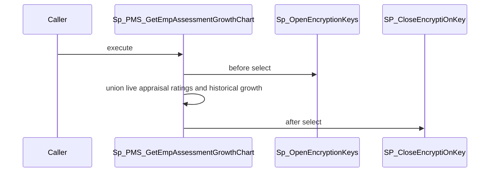
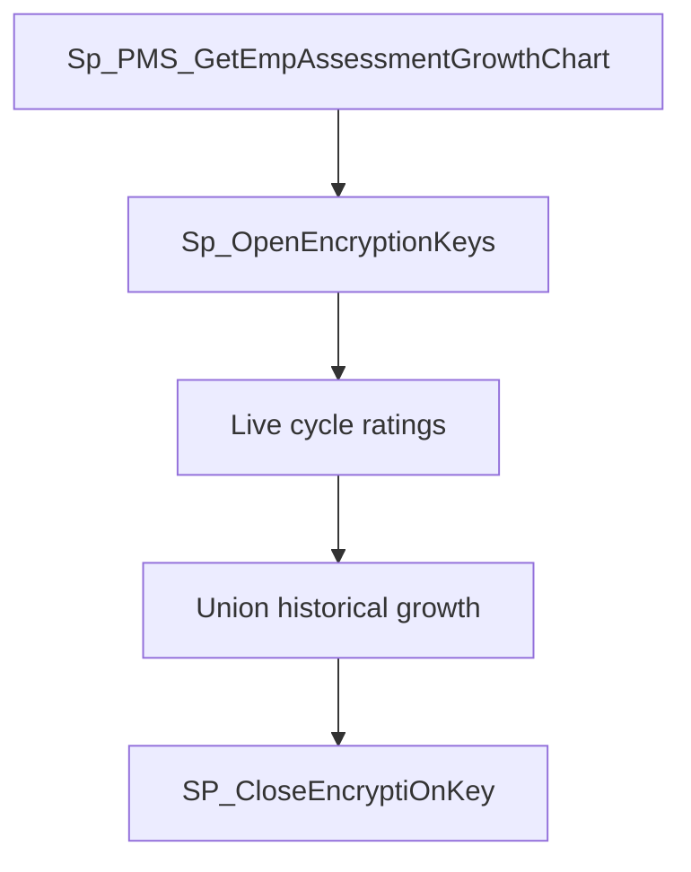

# Sp_PMS_GetEmpAssessmentGrowthChart

## What it does

Returns the selected employee's appraisal growth points: final ratings from completed self-appraisal cycles plus historical growth rows. Used by the PMS Dashboard employee growth chart.

## Parameters

| Name | Direction | What it is for |
|---|---|---|
| `@EmployerID` | in | Employer for historical growth rows |
| `@EmployeeId` | in | Employee whose ratings are plotted |

## Call sequence

## Callers

No other procedure or function calls this object. App caller: `performanceAssessmentDAL.GetEmpAssessmentGrowthChart`.

## Nested

| Object | Kind | When | Page |
|---|---|---|---|
| `Sp_OpenEncryptionKeys` | procedure | start | [Sp_OpenEncryptionKeys](/docs/database/hrms/Sp_OpenEncryptionKeys) |
| `SP_CloseEncryptiOnKey` | procedure | end | [SP_CloseEncryptiOnKey](/docs/database/hrms/SP_CloseEncryptiOnKey) |

## Steps

In `HRMS-DATABASE/HRMS/STOREPROCEDURE/Sp_PMS_GetEmpAssessmentGrowthChart.sql`:

1. Execute `Sp_OpenEncryptionKeys`.
2. Build live ratings from `TPMSEmployeeSelfAppraisal` joined to cycle mapping, appraisal cycles, cumulative ratings, workflow, employee info, and category master for `@EmployeeId`, requiring at least one competency rating level.
3. Compute final rating vs max rating from the cycle score method (rating / weightage / measure).
4. Union historical rows from `TPMS_HistoricalEmployeeGrowthData` for the same employee and employer.
5. Return display strings such as rating over max with percentage; execute `SP_CloseEncryptiOnKey`.

## Tables

| Table | Read or write |
|---|---|
| `dbo.TPMSEmployeeSelfAppraisal` | read |
| `dbo.TPMSEmployeeAppraisalCycleMapping` | read |
| `dbo.TPMSAppraisalCycles` | read |
| `dbo.TPMSAppraisalCumulativeRating` | read |
| `dbo.TPMS_AppraisalReviewFrequency` | read |
| `dbo.TRequestWorkflows` | read |
| `dbo.TEmployeeInfo` | read |
| `dbo.TEmployee` | read |
| `dbo.TPMSEmployerConfiguration` | read |
| `dbo.TPMSCategoryMaster` | read |
| `dbo.TPMSRatingScaleDetails` | read |
| `dbo.TPMSWeightageScaleDetails` | read |
| `dbo.TPMSEmployeeCompetencyRatings` | read |
| `dbo.TPMS_HistoricalEmployeeGrowthData` | read |

## Flow

