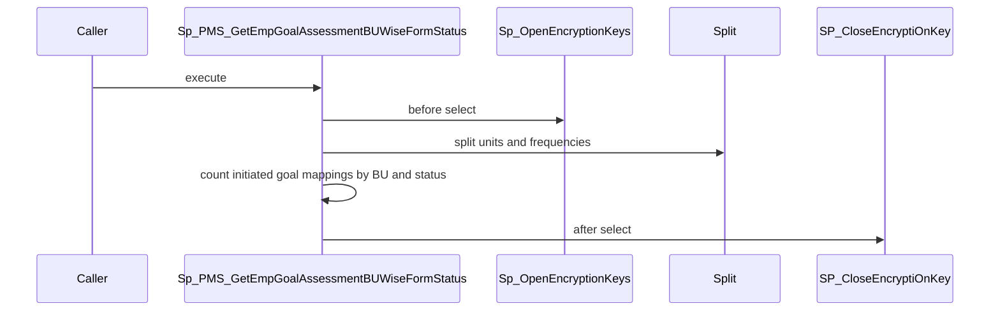
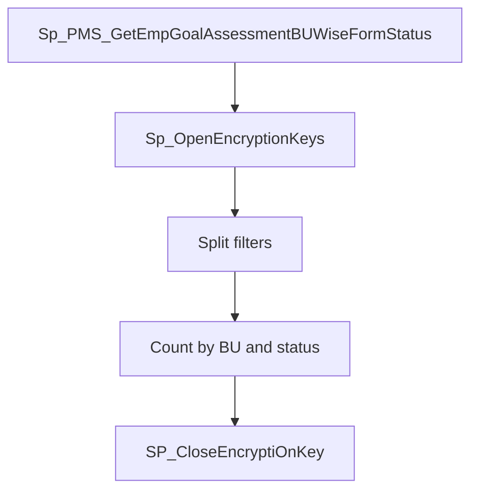

# Sp_PMS_GetEmpGoalAssessmentBUWiseFormStatus

## What it does

Counts initiated goal-mapping forms by business unit and derived form status (Pending, Saved, Submitted, Approved, Acknowledged, Force Closed) for the PMS Dashboard Goal Settings BU chart.

## Parameters

| Name | Direction | What it is for |
|---|---|---|
| `@EmployerID` | in | Employer on `TEmployeeInfo` |
| `@ReviewFrequencyId` | in | Goal review frequency id(s) |
| `@OrganizationUnits` | in | Business unit filter, or `0` / null for all |

## Call sequence

## Callers

No other procedure or function calls this object. App caller: `performanceAssessmentDAL.GetEmpGoalAssessmentBUWiseFormStatus`.

## Nested

| Object | Kind | When | Page |
|---|---|---|---|
| `Sp_OpenEncryptionKeys` | procedure | start | [Sp_OpenEncryptionKeys](/docs/database/hrms/Sp_OpenEncryptionKeys) |
| `Split` | function | CSV parameters | [Split](/docs/database/hrms/Split) |
| `SP_CloseEncryptiOnKey` | procedure | end | [SP_CloseEncryptiOnKey](/docs/database/hrms/SP_CloseEncryptiOnKey) |

## Steps

In `HRMS-DATABASE/HRMS/STOREPROCEDURE/Sp_PMS_GetEmpGoalAssessmentBUWiseFormStatus.sql`:

1. Execute `Sp_OpenEncryptionKeys`.
2. Split organization units and review frequencies.
3. Join employee info, goal mapping, goal setting, and goal review frequency; keep initiated rows for the employer and frequency filter.
4. Derive form status from submit / approve / acknowledge / save / force-close flags; group by unit and status.
5. Return coloured series; execute `SP_CloseEncryptiOnKey`.

## Tables

| Table | Read or write |
|---|---|
| `dbo.TEmployeeInfo` | read |
| `dbo.TEmployee` | read |
| `dbo.TPMSEmployeeGoalMapping` | read |
| `dbo.TPMSEmployerConfiguration` | read |
| `dbo.TPMSEmployeeGoalSetting` | read |
| `dbo.TPMS_GoalSettingReviewFrequency` | read |
| `dbo.TOrgHierarchyDetails` | read |

## Flow

