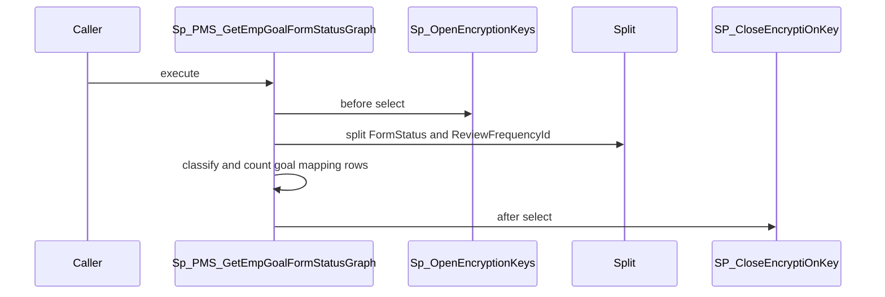
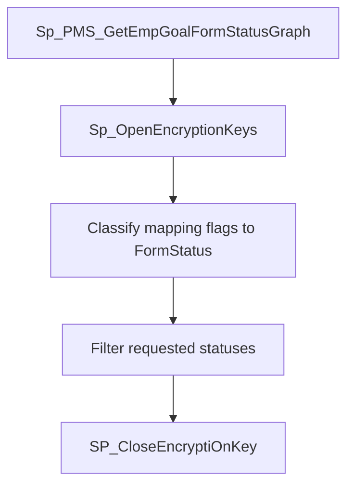

# Sp_PMS_GetEmpGoalFormStatusGraph

## What it does

Derives goal-form statuses from `TPMSEmployeeGoalMapping` flags (saved / submitted / approved / acknowledged / force closed) and returns counts with colours for the PMS Dashboard Goal Settings form-status chart.

## Parameters

| Name | Direction | What it is for |
|---|---|---|
| `@EmployerID` | in | Present on the signature; filter uses mapping employer via configuration join |
| `@ReviewFrequencyId` | in | Goal review frequency id(s) |
| `@FormStatus` | in | Status filter; `'0'` expands to Pending,Submitted,Approved,Acknowledged,Force Closed |

## Call sequence

## Callers

No other procedure or function calls this object. App caller: `performanceAssessmentDAL.GetEmpGoalFormStatusGraph`.

## Nested

| Object | Kind | When | Page |
|---|---|---|---|
| `Sp_OpenEncryptionKeys` | procedure | start | [Sp_OpenEncryptionKeys](/docs/database/hrms/Sp_OpenEncryptionKeys) |
| `Split` | function | CSV parameters | [Split](/docs/database/hrms/Split) |
| `SP_CloseEncryptiOnKey` | procedure | end | [SP_CloseEncryptiOnKey](/docs/database/hrms/SP_CloseEncryptiOnKey) |

## Steps

In `HRMS-DATABASE/HRMS/STOREPROCEDURE/Sp_PMS_GetEmpGoalFormStatusGraph.sql`:

1. Execute `Sp_OpenEncryptionKeys`.
2. When `@FormStatus = '0'`, replace with the full status list; otherwise append a comma and split.
3. Split `@ReviewFrequencyId`.
4. Classify each `tpmsemployeegoalmapping` row using form flags and `TPMSEmployerConfiguration.IsSelfassessmentIsRequired`, count by derived status, then filter to requested statuses.
5. Attach colours and sequence; execute `SP_CloseEncryptiOnKey`.

## Tables

| Table | Read or write |
|---|---|
| `dbo.TPMSEmployeeGoalMapping` | read |
| `dbo.TPMSEmployerConfiguration` | read |

## Flow

