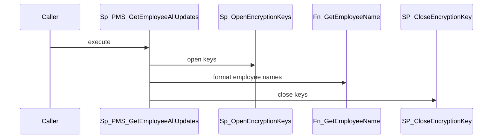
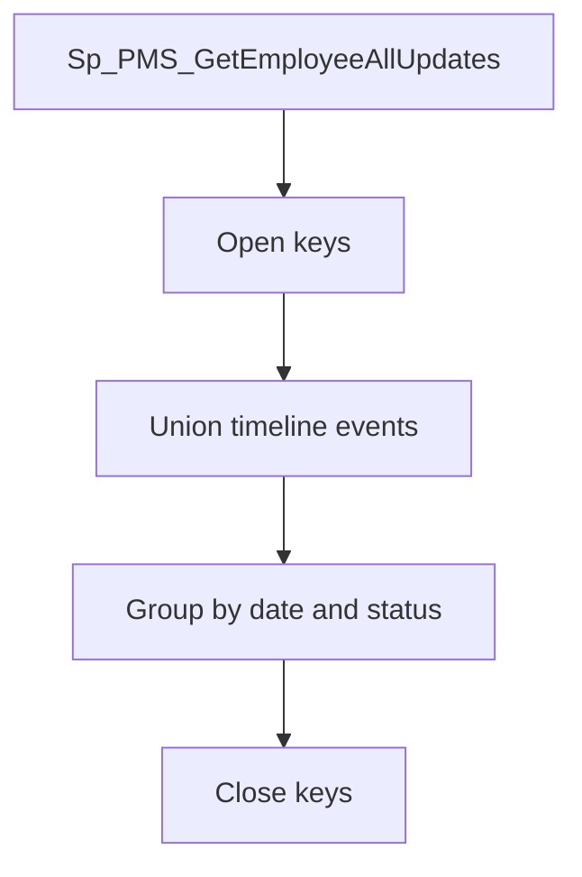

# Sp_PMS_GetEmployeeAllUpdates

## What it does

Builds the “See all updates” timeline for one self-assessment form: cycle initiated, employee submitted, pending/approved workflow levels, employee acknowledged, and force-closed. Rows are collapsed by date and status before return.

## Parameters

| Name | Direction | What it is for |
|---|---|---|
| `@AppraisalFormId` | in | `TPMSEmployeeSelfAppraisal.TransId` |

## Call sequence

## Callers

No other procedure or function calls this object.

## Nested

| Object | Kind | When | Page |
|---|---|---|---|
| `Sp_OpenEncryptionKeys` | procedure | start | [Sp_OpenEncryptionKeys](/docs/database/hrms/Sp_OpenEncryptionKeys) |
| `Fn_GetEmployeeName` | function | name formatting | [Fn_GetEmployeeName](/docs/database/hrms/Fn_GetEmployeeName) |
| `SP_CloseEncryptionKey` | procedure | end | [SP_CloseEncryptionKey](/docs/database/hrms/SP_CloseEncryptionKey) |

## Steps

Script: `HRMS-DATABASE/HRMS/STOREPROCEDURE/Sp_PMS_GetEmployeeAllUpdates.sql`.

1. Open encryption keys.
2. Insert unioned timeline events into `@lv_SeeAllUpdates` from self-appraisal, `TRequestWorkflows` (`SelfAssessment`), and config flags on `TPMSEmployerConfiguration`.
3. Aggregate by created date / form status and return distinct rows ordered by `Transid` descending.
4. Close encryption keys.

## Tables

| Table | Read or write |
|---|---|
| `TPMSEmployeeSelfAppraisal` | read |
| `TPMSAppraisalCycles` | read |
| `TEmployeeInfo` | read |
| `TPMSEmployerConfiguration` | read |
| `TRequestWorkflows` | read |

## Flow

