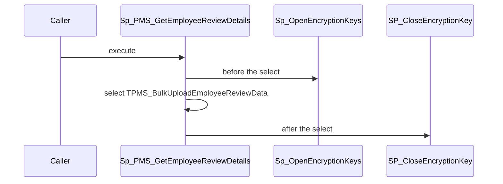
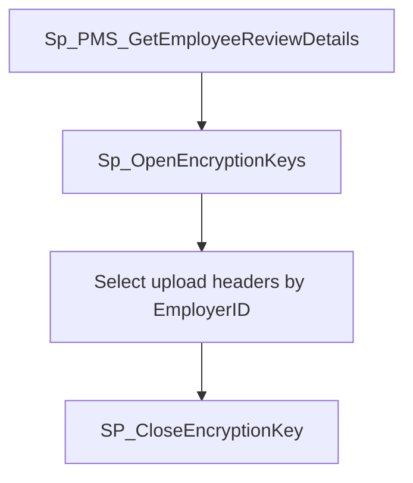

# Sp_PMS_GetEmployeeReviewDetails

## What it does

Lists review-manager bulk-upload header rows for one employer. After opening encryption keys it selects `ReviewDataId` (as `BulkID`), `UploadedFileName`, `Comments`, `CreatedBy`, `CreatedDate`, and `DirectoryPath` from `TPMS_BulkUploadEmployeeReviewData` where `EmployerID` matches, then closes encryption keys. The select itself does not decrypt columns.

## Parameters

| Name | Direction | What it is for |
|---|---|---|
| `@EmployerID` | in | Employer whose upload headers to return |

## Call sequence

## Callers

No other procedure or function calls this object. `PerformanceManagementDAL.GetEmployeeReviewDetails` executes it from Employee Bulk Update (`EmployeeBulkUpdate.aspx.cs`).

## Nested

| Object | Kind | When | Page |
|---|---|---|---|
| `Sp_OpenEncryptionKeys` | procedure | start of the body | [Sp_OpenEncryptionKeys](/docs/database/hrms/Sp_OpenEncryptionKeys) |
| `SP_CloseEncryptionKey` | procedure | end of the body (script spells `SP_CloseEncryptiOnKey`) | [SP_CloseEncryptionKey](/docs/database/hrms/SP_CloseEncryptionKey) |

## Steps

From `HRMS-DATABASE/HRMS/STOREPROCEDURE/Sp_PMS_GetEmployeeReviewDetails.sql`:

1. Execute `Sp_OpenEncryptionKeys`.
2. Select bulk-upload header columns from `TPMS_BulkUploadEmployeeReviewData` for `@EmployerID`.
3. Execute `SP_CloseEncryptionKey` (as written in the script).

## Tables

| Table | Read or write |
|---|---|
| `dbo.TPMS_BulkUploadEmployeeReviewData` | read |

## Flow

