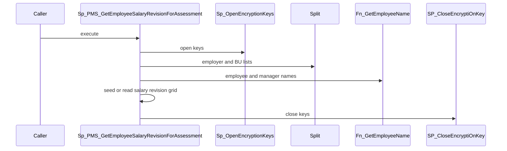
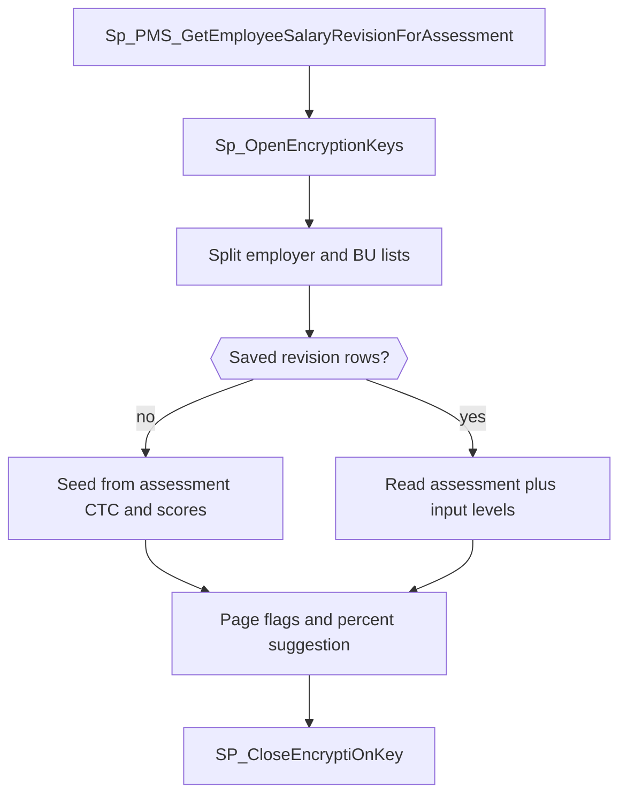

# Sp_PMS_GetEmployeeSalaryRevisionForAssessment

## What it does

Builds the Salary Recommendations employee grid for one or more employers, an appraisal cycle, optional business-unit filter, and the logged-in employee. Opens encryption keys, splits employer/BU CSV lists via `Split`, then either seeds rows from completed self-assessment / Normalization / `TEmpSalary` when no `TPMSSalaryRevForEmployeeAssessment` rows exist yet, or returns the saved assessment snapshot joined to per-level `TPMSSalaryRevInputForEmployeeAssessment` hike columns and page flags (save/submit/approve/pullback/freeze/history/revoke). Suggested `SalaryRevisionPercent` comes from `TPMSSalaryRecPercentageForRatingScaleDetails` using FinalScore or Normalization. API decrypts CTC/hike fields after the result returns.

## Parameters

| Name | Direction | What it is for |
|---|---|---|
| `@EmployerIds` | in | Comma-separated employer ids |
| `@AppraisalCycleId` | in | Cycle id (also used as AssessmentId); default `'0'` |
| `@OrganizationUnits` | in | Comma-separated BU ids; empty/null means all |
| `@EmployeeId` | in | Logged-in employee (drives role / flag columns) |

## Call sequence

## Callers

No other procedure or function calls this object. `performanceAssessmentDAL.GetEmployeeSalaryRevisionForAssessment` executes it for Salary Recommendations Search / auto-load.

## Nested

| Object | Kind | When | Page |
|---|---|---|---|
| `Sp_OpenEncryptionKeys` | procedure | start | [Sp_OpenEncryptionKeys](/docs/database/hrms/Sp_OpenEncryptionKeys) |
| `Split` | function | employer / BU CSV | [Split](/docs/database/hrms/Split) |
| `Fn_GetEmployeeName` | function | names and status text | [Fn_GetEmployeeName](/docs/database/hrms/Fn_GetEmployeeName) |
| `SP_CloseEncryptiOnKey` | procedure | end (script spelling) | [SP_CloseEncryptiOnKey](/docs/database/hrms/SP_CloseEncryptiOnKey) |

## Steps

1. Script is `HRMS-DATABASE/HRMS/STOREPROCEDURE/Sp_PMS_GetEmployeeSalaryRevisionForAssessment.sql`.
2. `EXEC Sp_OpenEncryptionKeys`.
3. Split `@EmployerIds` / `@OrganizationUnits` into table variables.
4. If no rows in `TPMSSalaryRevForEmployeeAssessment` for the cycle, SELECT seed grid from self-appraisal, mapping, salary, Normalization, rating scale, and workflow role flags.
5. Else SELECT saved assessment rows plus pivoted L1/L2/Final input columns and UI enable flags.
6. Compute suggested percent from mapping scale using Normalization or FinalScore.
7. `EXEC SP_CloseEncryptiOnKey`.

## Tables

| Table | Read or write |
|---|---|
| `TPMSSalaryRevForEmployeeAssessment` | read |
| `TPMSSalaryRevInputForEmployeeAssessment` | read |
| `TPMSAppraisalCycles` | read |
| `TPMSEmployeeSelfAppraisal` | read |
| `TPMSEmployeeAppraisalCycleMapping` | read |
| `TPMSEmployeeAppraisalForBellCurve` | read |
| `TPMS_AppraisalReviewFrequency` | read |
| `TPMSSalaryRecPercentageForRatingScaleDetails` | read |
| `TPMSRatingScaleDetails` / `TPMSWeightageScaleDetails` | read |
| `TEmpSalary` | read |
| `TEmployeeInfo` / `TEmployeeRoleMaster` / `TTitle` / `TOrgHierarchyDetails` | read |
| `TWorkflowManagement` / `TRequestWorkflows` | read |

## Unresolved calls

None on the live path.

## Flow

