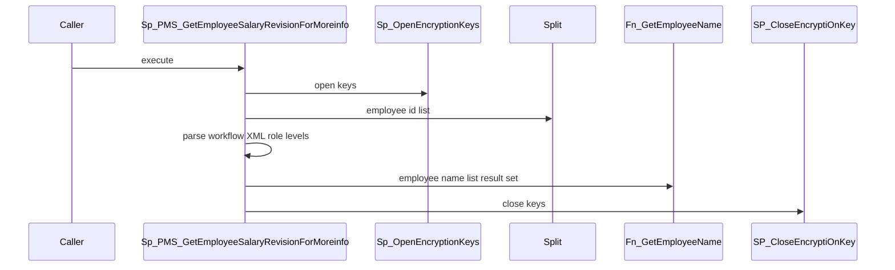
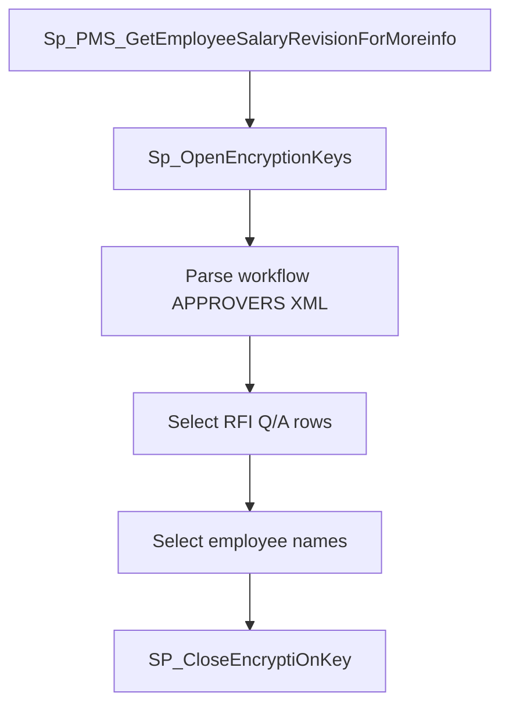

# Sp_PMS_GetEmployeeSalaryRevisionForMoreinfo

## What it does

Loads Request-for-Information threads for Salary Recommendations. Opens encryption keys, splits `@EmployeeId` CSV, reads `SalaryRecommendations` workflow tree XML to map approval levels to role names, then returns RFI Q/A rows from `TPMSSalaryRevisionForMoreInfo` / `TPMSViewSalaryRevisionForMoreInfo` with HTML log text, plus a second result set of employee display names for the dialog tabs.

## Parameters

| Name | Direction | What it is for |
|---|---|---|
| `@AssessmentId` | in | Appraisal cycle id |
| `@EmployeeId` | in | Comma-separated employee ids in the RFI selection |

## Call sequence

## Callers

No other procedure or function calls this object. `performanceAssessmentDAL.GetEmployeeSalaryRevisionForMoreinfo` executes it for the RFI dialog.

## Nested

| Object | Kind | When | Page |
|---|---|---|---|
| `Sp_OpenEncryptionKeys` | procedure | start | [Sp_OpenEncryptionKeys](/docs/database/hrms/Sp_OpenEncryptionKeys) |
| `Split` | function | employee CSV | [Split](/docs/database/hrms/Split) |
| `Fn_GetEmployeeName` | function | employee list | [Fn_GetEmployeeName](/docs/database/hrms/Fn_GetEmployeeName) |
| `SP_CloseEncryptiOnKey` | procedure | end | [SP_CloseEncryptiOnKey](/docs/database/hrms/SP_CloseEncryptiOnKey) |

## Steps

1. Script is `HRMS-DATABASE/HRMS/STOREPROCEDURE/Sp_PMS_GetEmployeeSalaryRevisionForMoreinfo.sql`.
2. Open keys; resolve employer and workflow id; parse APPROVERS nodes into a role table.
3. SELECT RFI conversation rows for the employee set with Asked by / Answered by HTML.
4. SELECT employee name list; close keys.

## Tables

| Table | Read or write |
|---|---|
| `TPMSAppraisalCycles` | read |
| `TWorkflowManagement` | read |
| `TPMSSalaryRevisionForMoreInfo` | read |
| `TPMSViewSalaryRevisionForMoreInfo` | read |
| `TEmployeeInfo` | read |

## Flow

