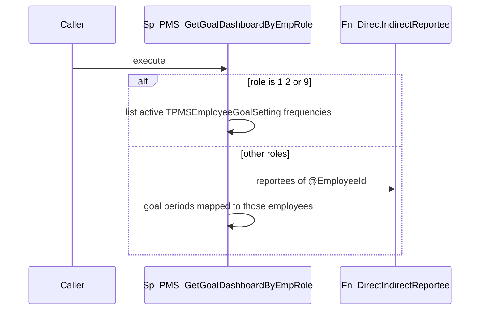
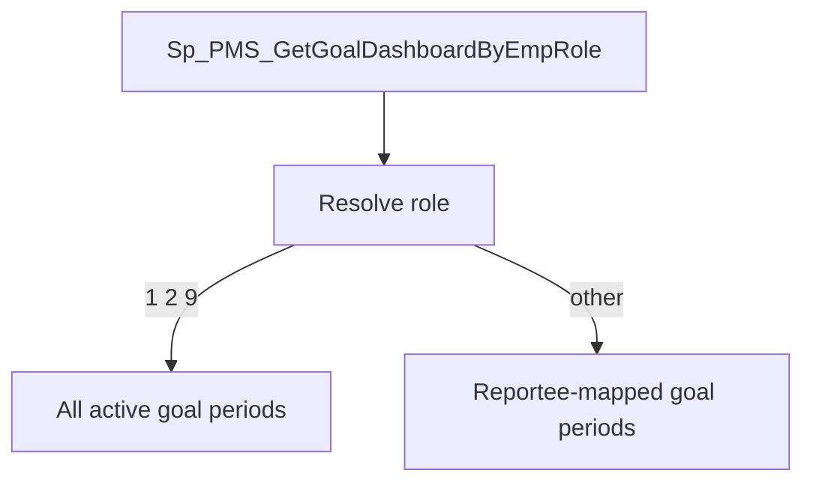

# Sp_PMS_GetGoalDashboardByEmpRole

## What it does

Returns goal-period / review-frequency options for the PMS Dashboard Goal Settings view. Roles 1, 2, and 9 see every active goal period for the employer with an active form date. Other roles see periods that map a reportee through `TPMSEmployeeGoalMapping`.

## Parameters

| Name | Direction | What it is for |
|---|---|---|
| `@EmployeeId` | in | Signed-in employee for role and reportee scope |
| `@EmployerId` | in | Employer whose goal periods are listed |

## Call sequence

## Callers

No other procedure or function calls this object. App caller: `performanceAssessmentDAL.GetGoalPeriodDetails` from PMS Dashboard.

## Nested

| Object | Kind | When | Page |
|---|---|---|---|
| `Fn_DirectIndirectReportee` | function | non-admin / non-HR role branch | [Fn_DirectIndirectReportee](/docs/database/hrms/Fn_DirectIndirectReportee) |

## Steps

In `HRMS-DATABASE/HRMS/STOREPROCEDURE/Sp_PMS_GetGoalDashboardByEmpRole.sql`:

1. Read employer name from `TPMSEmployerConfiguration`.
2. Resolve role for `@EmployeeId`.
3. For roles 1, 2, 9 return distinct `GoalSettingId`, period name plus review frequency, and `ReviewFrequencyId` from `TPMSEmployeeGoalSetting` joined to `TPMS_GoalSettingReviewFrequency`.
4. Otherwise restrict to `tpmsemployeegoalmapping` employees in `Fn_DirectIndirectReportee(@EmployeeId, -2)`.
5. Order by goal setting id descending, review frequency ascending.

## Tables

| Table | Read or write |
|---|---|
| `dbo.TPMSEmployerConfiguration` | read |
| `dbo.TUsers` | read |
| `dbo.TRoles` | read |
| `dbo.TUserEmployee` | read |
| `dbo.TEmployee` | read |
| `dbo.TPMSEmployeeGoalSetting` | read |
| `dbo.TPMS_GoalSettingReviewFrequency` | read |
| `dbo.TPMSEmployeeGoalMapping` | read |

## Flow

