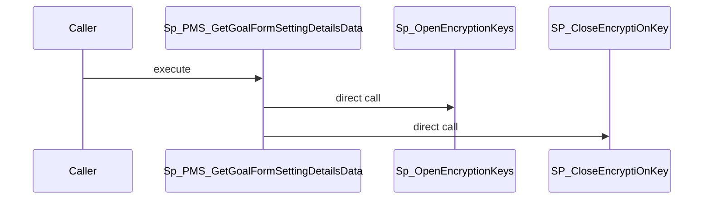
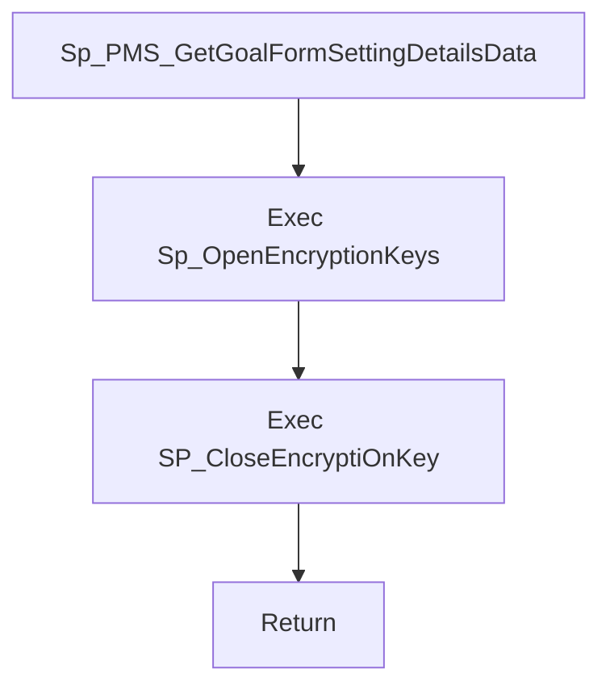

# Sp_PMS_GetGoalFormSettingDetailsData

## What it does

Stored procedure `Sp_PMS_GetGoalFormSettingDetailsData`. Reads `TPMSEmployeeGoalFormSettingDetails`. Calls `Sp_OpenEncryptionKeys`, `SP_CloseEncryptiOnKey`.

## Parameters

| Name | Direction | What it is for |
|---|---|---|
| `@FormID` | in | Int |

## Call sequence

## Callers

No other procedure or function calls this object.

## Nested

| Object | Kind | When | Page |
|---|---|---|---|
| `Sp_OpenEncryptionKeys` | procedure | direct call | [Sp_OpenEncryptionKeys](/docs/database/hrms/Sp_OpenEncryptionKeys) |
| `SP_CloseEncryptiOnKey` | procedure | direct call | [SP_CloseEncryptiOnKey](/docs/database/hrms/SP_CloseEncryptiOnKey) |

## Steps

1. Script is `HRMS-DATABASE/HRMS/STOREPROCEDURE/Sp_PMS_GetGoalFormSettingDetailsData.sql`.
2. Exec Sp_OpenEncryptionKeys
3. Exec SP_CloseEncryptiOnKey

## Tables

| Table | Read or write |
|---|---|
| `TPMSEmployeeGoalFormSettingDetails` | read |

## Flow

