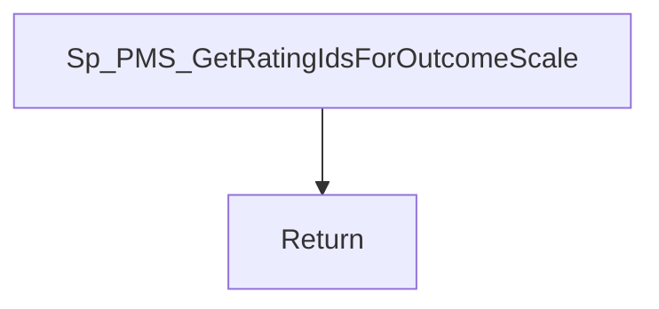

# Sp_PMS_GetRatingIdsForOutcomeScale

## What it does

Stored procedure `Sp_PMS_GetRatingIdsForOutcomeScale`. Reads `TPMSRatingMaster`. Calls no other procedure or function.

## Parameters

| Name | Direction | What it is for |
|---|---|---|
| — | — | No parameter list before AS |

## Call sequence

Calls no other procedures or functions.

## Callers

No other procedure or function calls this object.

## Nested

Calls no other procedures or functions.

## Steps

1. Script is `HRMS-DATABASE/HRMS/STOREPROCEDURE/Sp_PMS_GetRatingIdsForOutcomeScale.sql`.

## Tables

| Table | Read or write |
|---|---|
| `TPMSRatingMaster` | read |

## Flow

