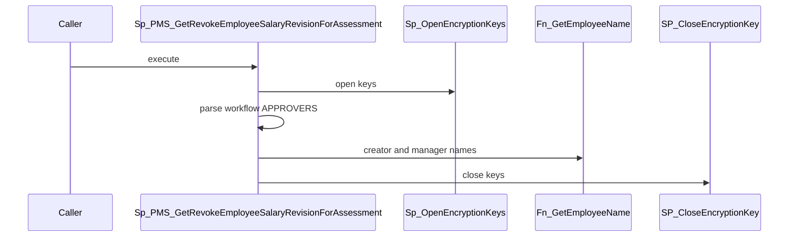
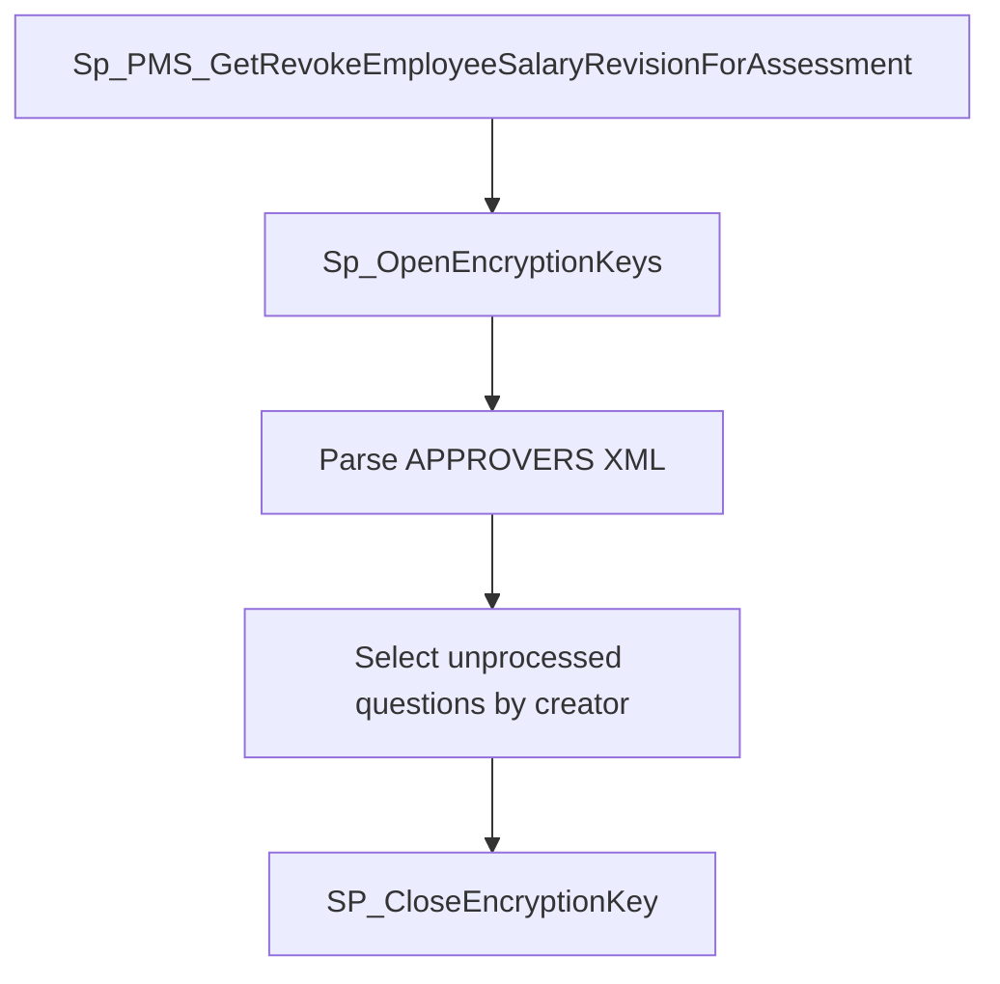

# Sp_PMS_GetRevokeEmployeeSalaryRevisionForAssessment

## What it does

Lists unanswered Salary Recommendations RFI questions the logged-in employee raised (`CreatedBy = @EmployeeId`, `Type = 'Q'`, `IsProcessed = 0`) for a cycle. Opens encryption keys, maps workflow APPROVERS XML to role names, and returns rows with ReviewLevelFrom/To labels including `Fn_GetEmployeeName` for creator and manager.

## Parameters

| Name | Direction | What it is for |
|---|---|---|
| `@AppraisalCycleId` | in | Cycle id |
| `@EmployeeId` | in | Login employee (question creator) |

## Call sequence

## Callers

No other procedure or function calls this object. `performanceAssessmentDAL.GetRevokeEmployeeSalaryRevisionForAssessment` executes it for the Revoke dialog.

## Nested

| Object | Kind | When | Page |
|---|---|---|---|
| `Sp_OpenEncryptionKeys` | procedure | start | [Sp_OpenEncryptionKeys](/docs/database/hrms/Sp_OpenEncryptionKeys) |
| `Fn_GetEmployeeName` | function | level labels | [Fn_GetEmployeeName](/docs/database/hrms/Fn_GetEmployeeName) |
| `SP_CloseEncryptionKey` | procedure | end (script spelling) | [SP_CloseEncryptionKey](/docs/database/hrms/SP_CloseEncryptionKey) |

## Steps

1. Script is `HRMS-DATABASE/HRMS/STOREPROCEDURE/Sp_PMS_GetRevokeEmployeeSalaryRevisionForAssessment.sql`.
2. Resolve employer and workflow; parse APPROVERS into role table.
3. SELECT unprocessed questions created by `@EmployeeId`.
4. Close encryption keys.

## Tables

| Table | Read or write |
|---|---|
| `TPMSAppraisalCycles` | read |
| `TWorkflowManagement` | read |
| `TPMSSalaryRevisionForMoreInfo` | read |

## Flow

