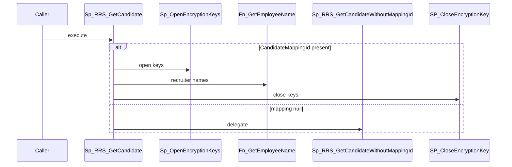
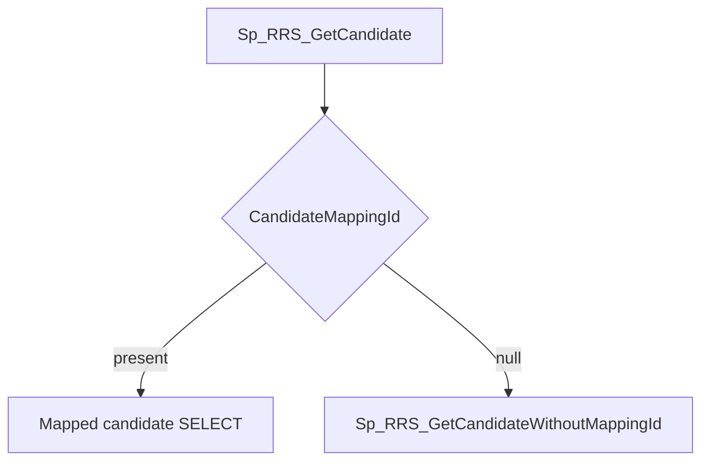

# Sp_RRS_GetCandidate

## What it does

Loads RRS candidate details for a candidate and employer. When `@CandidateMappingId` is supplied (and not `0`), it opens encryption keys and returns the mapped-candidate detail SELECT (recruiter name via `Fn_GetEmployeeName`, offer/CTC-related fields, comments, shortlist join). When mapping id is null, it delegates to `Sp_RRS_GetCandidateWithoutMappingId`. BGV UI calls without a mapping id, so the nested path is the live BGV path.

## Parameters

| Name | Direction | What it is for |
|---|---|---|
| `@Candidateid` | in | Candidate id |
| `@Employerid` | in | Employer id |
| `@CandidateMappingId` | in | Optional mapping; `0` coerced to null |

## Call sequence

## Callers

| Object | Kind | Page |
|---|---|---|
| `Sp_RRS_UpdateCandidateOffer` | procedure | No page yet |

Application caller: BGV API `employeeDAL.GetRrsCandidate` (no mapping id).

## Nested

| Object | Kind | When | Page |
|---|---|---|---|
| `Sp_OpenEncryptionKeys` | procedure | mapping present | [Sp_OpenEncryptionKeys](/docs/database/hrms/Sp_OpenEncryptionKeys) |
| `Fn_GetEmployeeName` | function | mapping present | [Fn_GetEmployeeName](/docs/database/hrms/Fn_GetEmployeeName) |
| `SP_CloseEncryptionKey` | procedure | mapping present | [SP_CloseEncryptionKey](/docs/database/hrms/SP_CloseEncryptionKey) |
| `Sp_RRS_GetCandidateWithoutMappingId` | procedure | mapping null | [Sp_RRS_GetCandidateWithoutMappingId](/docs/database/hrms/Sp_RRS_GetCandidateWithoutMappingId) |

## Steps

1. Script is `HRMS-DATABASE/HRMS/STOREPROCEDURE/Sp_RRS_GetCandidate.sql`.
2. Coerce `@CandidateMappingId = 0` to null.
3. If mapping present: open keys; load recommendation/CTC helpers; select mapped candidate detail; close keys.
4. Else: `EXEC Sp_RRS_GetCandidateWithoutMappingId`.

## Tables

| Table | Read or write |
|---|---|
| `dbo.TrrsHRInterviewRecommendation` | read (mapped path) |
| `dbo.TRRSCandidateMapping` | read (mapped path) |
| `dbo.TCandidateNetTakeHomeSalaryStructure` | read (mapped path) |
| `dbo.TRRSCandidate` / related RRS tables in SELECT | read |
| `dbo.TRRSShortListCandidate` | read (mapped path) |

## Flow

