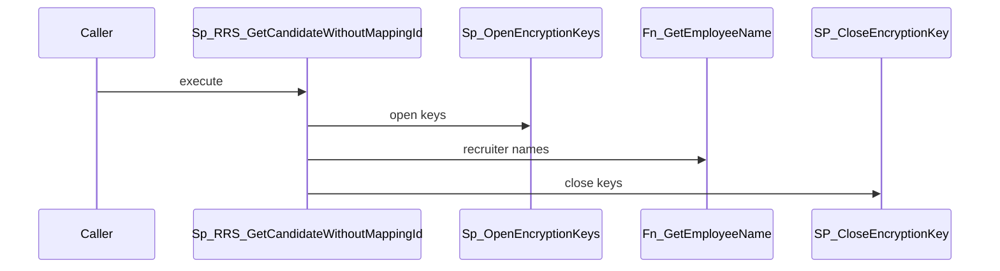
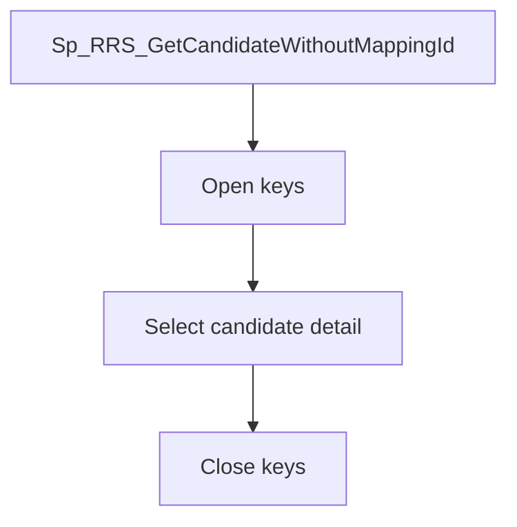

# Sp_RRS_GetCandidateWithoutMappingId

## What it does

Returns RRS candidate detail when no `CandidateMappingId` is supplied. Opens encryption keys, selects the candidate profile (including recruiter display name via `Fn_GetEmployeeName`) for `@Candidateid` and `@Employerid`, then closes keys. This is the path BGV uses when filling pre-employment candidate details.

## Parameters

| Name | Direction | What it is for |
|---|---|---|
| `@Candidateid` | in | Candidate id |
| `@Employerid` | in | Employer id |

## Call sequence

## Callers

| Object | Kind | Page |
|---|---|---|
| `Sp_RRS_GetCandidate` | procedure | [Sp_RRS_GetCandidate](/docs/database/hrms/Sp_RRS_GetCandidate) |

## Nested

| Object | Kind | When | Page |
|---|---|---|---|
| `Sp_OpenEncryptionKeys` | procedure | always | [Sp_OpenEncryptionKeys](/docs/database/hrms/Sp_OpenEncryptionKeys) |
| `Fn_GetEmployeeName` | function | recruiter display columns | [Fn_GetEmployeeName](/docs/database/hrms/Fn_GetEmployeeName) |
| `SP_CloseEncryptionKey` | procedure | always | [SP_CloseEncryptionKey](/docs/database/hrms/SP_CloseEncryptionKey) |

## Steps

1. Script is `HRMS-DATABASE/HRMS/STOREPROCEDURE/Sp_RRS_GetCandidateWithoutMappingId.sql`.
2. Open encryption keys.
3. Select candidate detail for the employer/candidate without mapping-id joins required by the sibling procedure.
4. Close encryption keys.

## Tables

| Table | Read or write |
|---|---|
| `dbo.TRRSCandidate` / related RRS tables in SELECT | read |

## Flow

