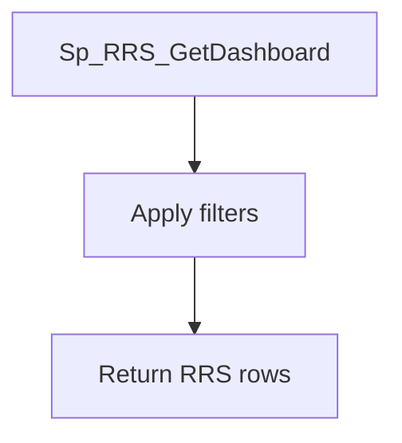

# Sp_RRS_GetDashboard

## What it does

Returns RRS (resource requisition) dashboard rows used by Initiate Reallocation when picking an RRS.

## Parameters

| Name | Direction | What it is for |
|---|---|---|
| `@Employerid` | in | Employer |
| `@Employeeid` | in | Employee |
| `@RrsStatus` | in | Optional status |
| `@RRSId` | in | Optional RRS id |
| `@ClientName` | in | Optional client name |
| `@MultiOrg` | in | Multi-org flag |
| `@NotificationId` | in | Notification flag |
| `@BusinessUnitId` | in | Optional BU |

## Call sequence

Calls no other procedures in the header path (see body for helper usage).

## Callers

RA WebAPI `raDAL` getRRSDetailsById from [Manage Allocation](/docs/guides/resource-allocation/manage-allocation).

## Nested

See script body for any helper calls; documented one level from Manage Allocation callers only.

## Steps

1. Script is `HRMS-DATABASE/HRMS/STOREPROCEDURE/Sp_RRS_GetDashboard.sql`.
2. Filter RRS master details by employer/employee and optional filters.

## Tables

| Table | Read or write |
|---|---|
| `RRS master / detail tables` | read |

## Unresolved calls

None.

## Flow

