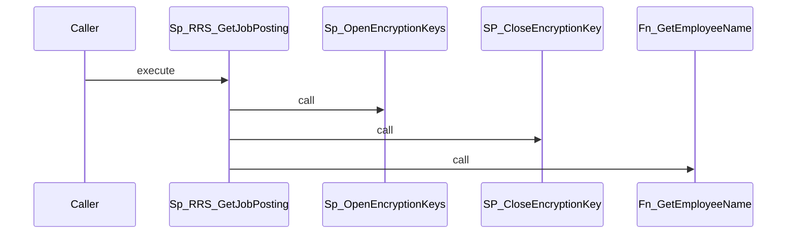
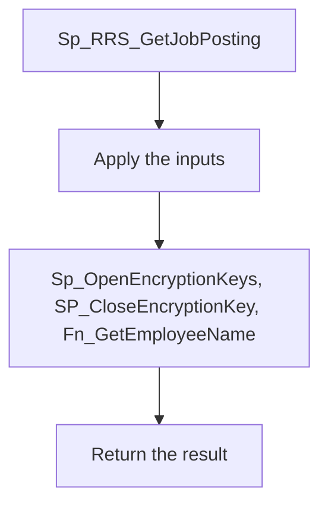

# Sp_RRS_GetJobPosting

## What it does

Returns active job postings for the employee id passed from the New Joinee / Refer a friend card.

## Parameters

| Name | Direction | What it is for |
|---|---|---|
| `@EmployeeId` | in | Employee the Home screen is loading or acting for (`INT`) |
| `@PostingType` | in | Job-posting filter. Null returns the active set (`VARCHAR(10)`) |
| `@isactive` | in | Hard-coded true by the recruitment data layer for this card (`BIT`) |

## Call sequence

## Callers

No other procedure or function under STOREPROCEDURE or FUNCTIONS executes this object.

## Nested

| Object | Kind | When | Page |
|---|---|---|---|
| `Sp_OpenEncryptionKeys` | procedure | Called while this object runs | [Sp_OpenEncryptionKeys](/docs/database/hrms/Sp_OpenEncryptionKeys) |
| `SP_CloseEncryptionKey` | procedure | Called while this object runs | [SP_CloseEncryptionKey](/docs/database/hrms/SP_CloseEncryptionKey) |
| `Fn_GetEmployeeName` | function | Called while this object runs | [Fn_GetEmployeeName](/docs/database/hrms/Fn_GetEmployeeName) |

## Steps

In `HRMS-DATABASE/HRMS/STOREPROCEDURE/Sp_RRS_GetJobPosting.sql`:

1. Returns active job postings for the employee id passed from the New Joinee / Refer a friend card.

## Tables

| Table | Read or write |
|---|---|
| `TEmployee` | read |
| `trrstransactiondetails` | read |
| `TQualificationName` | read |
| `split` | read |
| `TRecruiter` | read |
| `TEmployerDetails` | read |
| `TRRSjobposting` | read |
| `Trrsdetails` | read |
| `TLocation` | read |

## Flow

