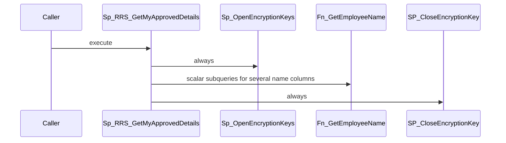
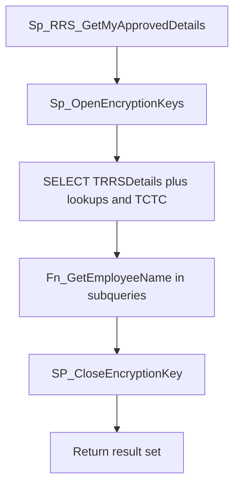

# Sp_RRS_GetMyApprovedDetails

## What it does

Returns recruitment requisitions (`TRRSDetails`) that the logged-in employee approved for a given employer, excluding status `Pending` and `Submitted`. Opens encryption keys, selects display columns (title fragment, dates, organisation unit, project/client, approver and manager names, skills aggregate, CTC min/max), then closes encryption keys. Used by the **RRS Approved By Me** WebForms grid.

## Parameters

| Name | Direction | What it is for |
|---|---|---|
| `@Employerid` | in | Employer whose RRS rows are returned |
| `@Employeeid` | in | Approver employee id matched to `TRRSDetails.RRSApprovedBy` |

## Call sequence

## Callers

No other procedure or function under STOREPROCEDURE or FUNCTIONS executes this object.

## Nested

| Object | Kind | When | Page |
|---|---|---|---|
| `Sp_OpenEncryptionKeys` | procedure | Always, before the SELECT | [Sp_OpenEncryptionKeys](/docs/database/hrms/Sp_OpenEncryptionKeys) |
| `Fn_GetEmployeeName` | function | Scalar subqueries for hiring manager, approver, L1/L2, assigned-to, created-by names | [Fn_GetEmployeeName](/docs/database/hrms/Fn_GetEmployeeName) |
| `SP_CloseEncryptionKey` | procedure | Always, after the SELECT | [SP_CloseEncryptionKey](/docs/database/hrms/SP_CloseEncryptionKey) |

## Steps

In `HRMS-DATABASE/HRMS/STOREPROCEDURE/Sp_RRS_GetMyApprovedDetails.sql`:

1. `EXEC Sp_OpenEncryptionKeys`.
2. `SELECT` from `Trrsdetails Trsd` left-joined to `TCTC` on `RRSId = CTCParentID` and `CTCRefrenceType = 'TRRSDetails'`.
3. Derive display `RRSTitle` as the segment after the last `_` via `REVERSE` / `SUBSTRING` / `CHARINDEX`.
4. Resolve organisation unit, employee names (`Fn_GetEmployeeName` plus employment number where needed), designation, hiring reason, location (`TLocation`), billing type, and a comma-separated skill list from `tmskills` / `trrsskilldetails`.
5. Filter `RRSApprovedBy = @Employeeid`, `RRSStatus NOT IN ('Pending','Submitted')`, `EmployerId = @Employerid`.
6. Order by `RRSCreationDate` descending.
7. `EXEC SP_CloseEncryptionKey`.

## Tables

| Table | Read or write |
|---|---|
| `Trrsdetails` / `TRRSDetails` | read |
| `TCTC` | read |
| `TOrgHierarchyDetails` | read |
| `TEmployee` | read |
| `TEmployeeInfo` | read |
| `TTitle` | read |
| `THiringReason` | read |
| `TLocation` | read |
| `Tbillingtype` | read |
| `tmskills` / `TMSkills` | read |
| `trrsskilldetails` / `TRRSSkillDetails` | read |

## Flow

