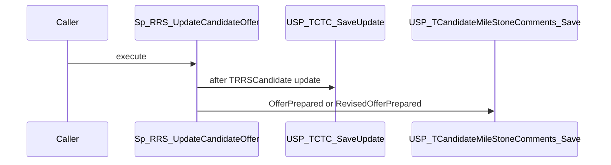
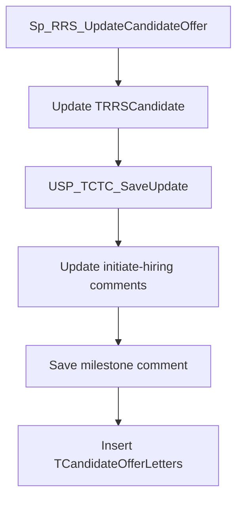

# Sp_RRS_UpdateCandidateOffer

## What it does

Persists offer-letter fields on `TRRSCandidate` (employment type, DOJ, CTC fixed/variable, offer letter path, bonuses, and related columns), updates CTC via `USP_TCTC_SaveUpdate`, refreshes initiate-hiring comment amounts, writes an offer-prepared (or revised) milestone comment, and inserts `TCandidateOfferLetters`.

## Parameters

| Name | Direction | What it is for |
|---|---|---|
| `@Candidateid` | in | Candidate to update |
| `@Employmenttype` / `@Permanentaddress` / `@Doj` | in | Employment basics |
| `@Authorizedsignatory` / `@Template` / `@OfferedDesignation` | in | Offer template / designation |
| `@Probationenddate` / `@Trainingenddate` / `@Contractualenddate` | in | End dates |
| `@Ctcfixed` / `@Ctcvariable` / `@OfferedCTCCurrency` | in | CTC amounts and currency |
| `@SalaryPath` / `@OfferLetterPath` / `@OfferAcceptancePath` | in | Document paths |
| `@UpdatedBy` | in | Audit user |
| `@RelocationCharges` / `@JoiningBonus` / `@NoticePeriodBU` | in | Offer extras |
| `@TakeHomeType` / `@SalaryStructureType` | in | Optional salary structure flags |

## Call sequence

## Callers

No other procedure or function calls this object (application callers include Offer Rolled Out `createOfferRolledOutLetter`).

## Nested

| Object | Kind | When | Page |
|---|---|---|---|
| `USP_TCTC_SaveUpdate` | procedure | after candidate update | [USP_TCTC_SaveUpdate](/docs/database/hrms/USP_TCTC_SaveUpdate) |
| `USP_TCandidateMileStoneComments_Save` | procedure | after determining milestone type | [USP_TCandidateMileStoneComments_Save](/docs/database/hrms/USP_TCandidateMileStoneComments_Save) |

## Steps

1. Update `TRRSCandidate` offer columns.
2. Call `USP_TCTC_SaveUpdate` with fixed/variable CTC.
3. Update `TRRSCandidiateInitiateHiringComments` notice/joining/relocation amounts.
4. Choose milestone `RevisedOfferPrepared` vs `OfferPrepared` from mapping status.
5. Call `USP_TCandidateMileStoneComments_Save` and insert `TCandidateOfferLetters`.
6. Return `Errorcode = 0`.

## Tables

| Table | Read or write |
|---|---|
| `TRRSCandidate` | read / write |
| `TRRSCandidiateInitiateHiringComments` | write |
| `TRRSCandidateMapping` | read |
| `TCandidateMileStoneComments` | write via nested |
| `TCandidateOfferLetters` | write |
| `TCTC` | write via nested |

## Flow

