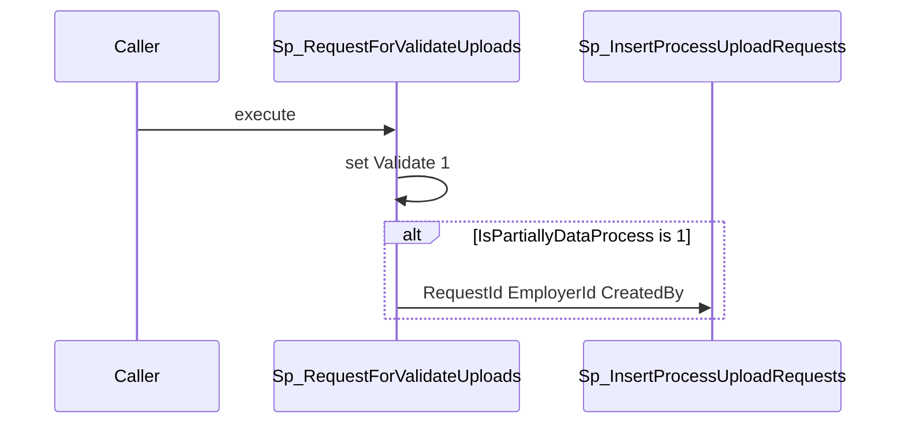
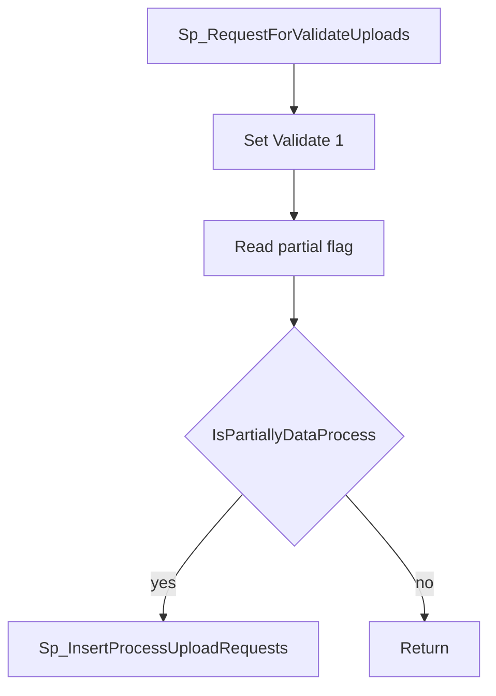

# Sp_RequestForValidateUploads

## What it does

Marks one Client Onboarding upload request as ready for validation (`Validate = 1`). When that request has `IsPartiallyDataProcess = 1`, it also inserts a process-queue row by calling `Sp_InsertProcessUploadRequests` with the request's employer and creator.

## Parameters

| Name | Direction | What it is for |
|---|---|---|
| `@RequestId` | in | `TBulkUploadRequests.RequestId` to validate |

## Call sequence

## Callers

Procedures and functions that call this object.

No other procedure or function calls this object. App caller: `bulkUploadDAL.ValidateUploadRequest` from Upload Files (`UploadedFilesGridComponent`).

## Nested

| Object | Kind | When | Page |
|---|---|---|---|
| `Sp_InsertProcessUploadRequests` | procedure | `@IsPartiallyDataProcess = 1` on the request | [Sp_InsertProcessUploadRequests](/docs/database/hrms/Sp_InsertProcessUploadRequests) |

## Steps

1. Script is `HRMS-DATABASE/HRMS/STOREPROCEDURE/Sp_RequestForValidateUploads.sql`.
2. `UPDATE TBulkUploadRequests SET Validate = 1` for `@RequestId`.
3. Read `CreatedBy`, `EmployerId`, and `IsPartiallyDataProcess` for that request.
4. When `IsPartiallyDataProcess = 1`, execute `Sp_InsertProcessUploadRequests`.

## Tables

| Table | Read or write |
|---|---|
| `dbo.TBulkUploadRequests` | read, write |

## Unresolved calls

None.

## Flow

