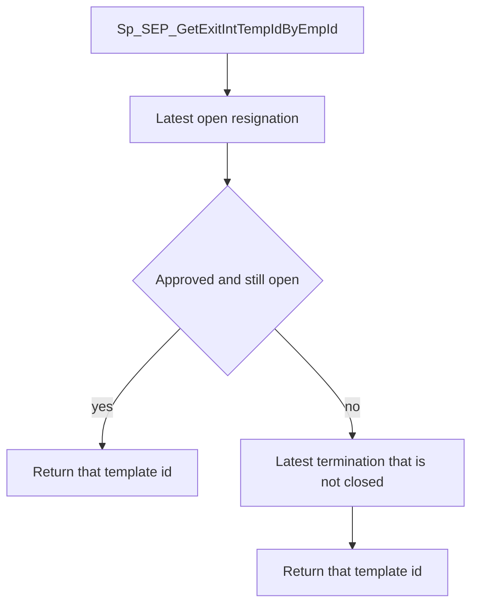

# Sp_SEP_GetExitIntTempIdByEmpId

## What it does

Returns one `ExitInterviewTemplateId` for an employee. It looks for the latest open resignation that is approved. When that row exists, it returns that resignation's template id. Otherwise it returns the template id on the employee's latest termination that is not closed. The result set can be empty when neither row matches.

## Parameters

| Name | Direction | What it is for |
|---|---|---|
| `@EmployeeId` | in | Employee whose open separation is read |

## Call sequence

Calls no other procedures or functions.

## Callers

| Object | Kind | Page |
|---|---|---|
| `SP_GetAssignedQuestionsWithCategory` | procedure | No page yet |
| `SP_SEP_GetAssignedQuestions` | procedure | [SP_SEP_GetAssignedQuestions](/docs/database/hrms/SP_SEP_GetAssignedQuestions) |

## Nested

Calls no other procedures or functions.

## Steps

1. Set `@ResignationId` to the maximum `ResignationId` in `TResignationDetails` for this employee where `IsResignationClose` is 0 (`Sp_SEP_GetExitIntTempIdByEmpId.sql`).
2. When a row exists for that id with `ApproveStatus` equal to `Approved` and `IsResignationClose` equal to 0, select `ExitInterviewTemplateId` from that row.
3. Otherwise set `@TerminationDetailId` to the maximum `TerminationDetailId` in `TTerminationDetail` for this employee.
4. Select `ExitInterviewTemplateId` from `TTerminationDetail` for that id where `IsTerminationClose` is 0.

## Tables

| Table | Read or write |
|---|---|
| `TResignationDetails` | read |
| `TTerminationDetail` | read |

`TResignationDetails.EmployeeId` references `TEmployee` (`FK_TResignationDetails_TEmployee`). `TTerminationDetail.EmployeeId` references `TEmployee` (`FK_TTerminationDetail_TEmployee`). `ExitInterviewTemplateId` has no foreign key in either table script.

## Flow

