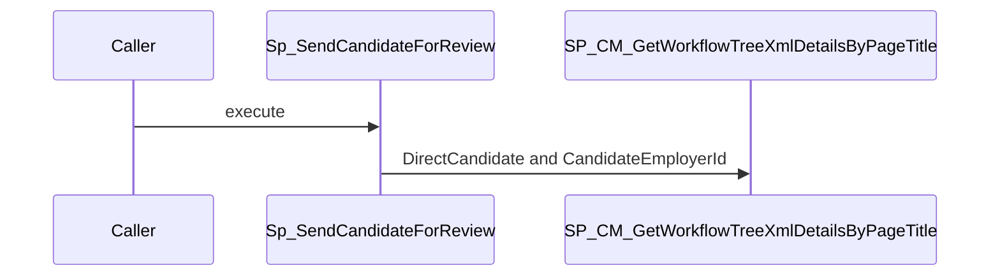
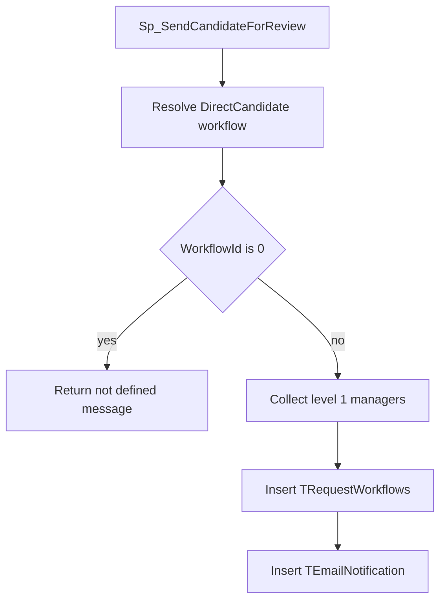

# Sp_SendCandidateForReview

## What it does

Starts the DirectCandidate approval workflow for an Offer Rolled Out candidate. Resolves the workflow for page title `DirectCandidate` on the candidate employer, inserts level-1 `TRequestWorkflows` rows for role-mapped managers, and queues `TEmailNotification` rows. Returns a failure message result set when no workflow is defined.

## Parameters

| Name | Direction | What it is for |
|---|---|---|
| `@CandidateId` | in | Candidate / request transaction id |
| `@LoggedInUser` | in | Creator of workflow rows |
| `@EmployerId` | in | Employer stamped on notifications |
| `@WorkflowId` | in | Overwritten from the resolved workflow (caller value ignored) |
| `@RequestType` | in | Stored on `TRequestWorkflows` (UI sends `DirectCandidate`) |
| `@CandidateEmployerId` | in | Employer passed into the workflow tree lookup |

## Call sequence

## Callers

No other procedure or function calls this object.

## Nested

| Object | Kind | When | Page |
|---|---|---|---|
| `SP_CM_GetWorkflowTreeXmlDetailsByPageTitle` | procedure | always, page title `DirectCandidate` | [SP_CM_GetWorkflowTreeXmlDetailsByPageTitle](/docs/database/hrms/SP_CM_GetWorkflowTreeXmlDetailsByPageTitle) |

## Steps

1. Call `SP_CM_GetWorkflowTreeXmlDetailsByPageTitle` with `'DirectCandidate'`, `@CandidateEmployerId`, null creator.
2. If no workflow id, return message `DirectCandidate workflow not defined...` with `IsSuccess = 0` and return.
3. Collect level-1 managers from `TWorkflowDetails` / `tRoleEmployeeMapping`.
4. Insert pending `TRequestWorkflows` rows (level 1, `ApproveStatus = 'P'`).
5. Insert `TEmailNotification` rows (`TemplateName = 'DirectCandidate'`, `STATUS = 'Pending'`).

## Tables

| Table | Read or write |
|---|---|
| `TWorkflowDetails` | read |
| `tRoleEmployeeMapping` | read |
| `TRequestWorkflows` | write |
| `TEmailNotification` | write |

## Flow

