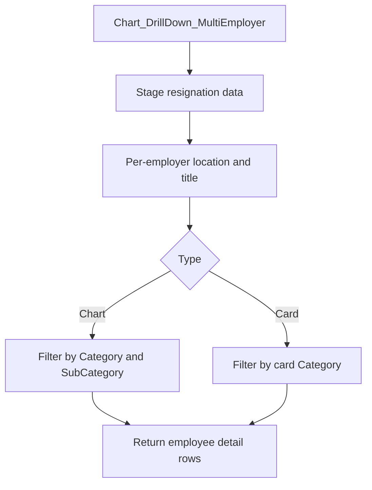

# Sp_SeparationDashboard_Chart_DrillDown_MultiEmployer

## What it does

Returns the employee-level rows behind a Separation Dashboard card or chart slice. It stages the same multi-employer latest-resignation dataset as the card SP, enriches with designation / work location / skills / age / tenure, then filters by `@CategoryName`, `@SubCategoryName`, optional `@ExcludeSubCategory`, and `@Type` (`Chart` vs `Card`). Output is a detail grid (employment number, names, org dimensions, resignation dates, status, reason, and related fields) for the drill-down dialog.

## Parameters

| Name | Direction | What it is for |
|---|---|---|
| `@ReportType` | in | `A` / `B` / `C` |
| `@LoginID` | in | Logged-in employee id for nested location scope |
| `@EmployerID` | in | Comma-separated employer ids (parameter name is singular; value is multi) |
| `@BusinessUnitID` | in | BU filter or `ALL` |
| `@BaseLocationID` | in | Location filter or `ALL` |
| `@FromDate` / `@ToDate` | in | Primary window |
| `@CompFromDate` / `@CompToDate` | in | Optional comparison window |
| `@CategoryName` | in | Chart category or card name to filter on |
| `@SubCategoryName` | in | Slice label(s); comma-separated for charts |
| `@ExcludeSubCategory` | in | Optional exclusion list for “Others” style slices |
| `@Type` | in | `Chart` or `Card` (drives which filter branch runs) |

## Call sequence

```mermaid
sequenceDiagram
  participant Caller
  participant Main as Sp_SeparationDashboard_Chart_DrillDown_MultiEmployer
  participant Open as Sp_OpenEncryptionKeys
  participant Loc as SP_EmployeeDashboard_GetLocationByEmployeeId
  participant Title as SP_CM_GetTitle
  Caller->>Main: execute
  Main->>Open: EXEC
  loop each EmployerId
    Main->>Loc: EXEC LoginID CurEmployerID
    Main->>Title: EXEC CurEmployerID
  end
  Main->>Main: filter by Category Type and return detail rows
```

## Callers

| Object | Kind | Page |
|---|---|---|
| `seperationDashboardDAL.GetSeparationDrillDownData` | app | [Separation Dashboard](/docs/guides/separation/separation-dashboard) |

## Nested

| Object | Kind | Page |
|---|---|---|
| `Sp_OpenEncryptionKeys` | procedure | [Sp_OpenEncryptionKeys](/docs/database/hrms/Sp_OpenEncryptionKeys) |
| `SP_EmployeeDashboard_GetLocationByEmployeeId` | procedure | [SP_EmployeeDashboard_GetLocationByEmployeeId](/docs/database/hrms/SP_EmployeeDashboard_GetLocationByEmployeeId) |
| `SP_CM_GetTitle` | procedure | [SP_CM_GetTitle](/docs/database/hrms/SP_CM_GetTitle) |
| `Fn_GetEmployeeName` | function | [Fn_GetEmployeeName](/docs/database/hrms/Fn_GetEmployeeName) |

## Steps

From `HRMS-DATABASE/HRMS/STOREPROCEDURE/Sp_SeparationDashboard_Chart_DrillDown_MultiEmployer.sql`:

1. Open encryption keys; normalize filters and dates.
2. Build `#temp_Resignation` / `#Resignation_Data` for selected employers and report type; compute Status / Experience; apply Active/InActive and BU/location deletes.
3. Cursor employers to populate `@WorkLocation` and `@Designation` via nested SPs.
4. Build enrichment temps and `#FINAL_FILTERED_DATA` (same family as the card SP).
5. When `@Type='Chart'`, branch on `@CategoryName` (`Status`, `BusinessUnit`, `Reason`, `Location`, …) to include or exclude subcategory values.
6. When `@Type='Card'`, filter by card `@CategoryName` semantics.
7. Select the matching employee detail rows (with `Fn_GetEmployeeName` for display names).

## Tables

| Table | Read or write |
|---|---|
| `dbo.TResignationDetails` | read |
| `dbo.TEmployeeInfo` | read |
| `dbo.TEmployee` | read |
| `dbo.torghierarchydetails` | read |
| `dbo.TResignation` | read |
| `dbo.tLocation` | read |
| `dbo.TMEmploymentTypes` | read |
| `dbo.TSeparationType` | read |
| `dbo.TORGChart` | read |
| `dbo.TRequestWorkflows` | read |
| `dbo.TActivityDetails` | read |
| `dbo.TEmployeeSkillDetails` / `dbo.TMSkills` | read |
| `dbo.TEmployeeRoleMaster` | read |
| `dbo.TLeaveRequestdays` | read (leave helper branch present in script) |

## Unresolved calls

None.

## Flow


