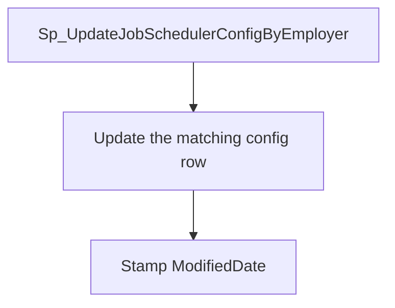

# Sp_UpdateJobSchedulerConfigByEmployer

## What it does

Updates one configuration row for an employer: scheduler name, key, value, who changed it, and the modified date. The configuration tab calls this from Save. It does not insert a new key.

## Parameters

| Name | Direction | What it is for |
|---|---|---|
| `@ConfigId` | in | Row to update |
| `@SchedulerName` | in | Job name written back onto the row |
| `@ConfigKey` | in | Key written back onto the row |
| `@ConfigValue` | in | New value |
| `@ModifiedBy` | in | Employee id of the signed-in user |
| `@EmployerId` | in | Organisation. Part of the where clause |

## Call sequence

Calls no other procedures or functions.

## Callers

Procedures and functions that call this object.

No other procedure or function calls this object.

## Nested

Calls no other procedures or functions.

## Steps

1. In `HRMS-DATABASE/HRMS/STOREPROCEDURE/Sp_UpdateJobSchedulerConfigByEmployer.sql`, update `TJobSchedulerConfiguration` set `SchedulerName`, `ConfigKey`, `ConfigValue`, `ModifiedBy`, and `ModifiedDate` = `GETDATE()`.

2. Limit the update to `ConfigId` = `@ConfigId` and `EmployerId` = `@EmployerId`.

## Tables

| Table | Read or write |
|---|---|
| `TJobSchedulerConfiguration` | write |

## Flow

