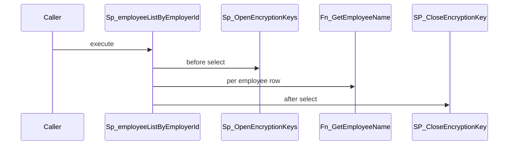
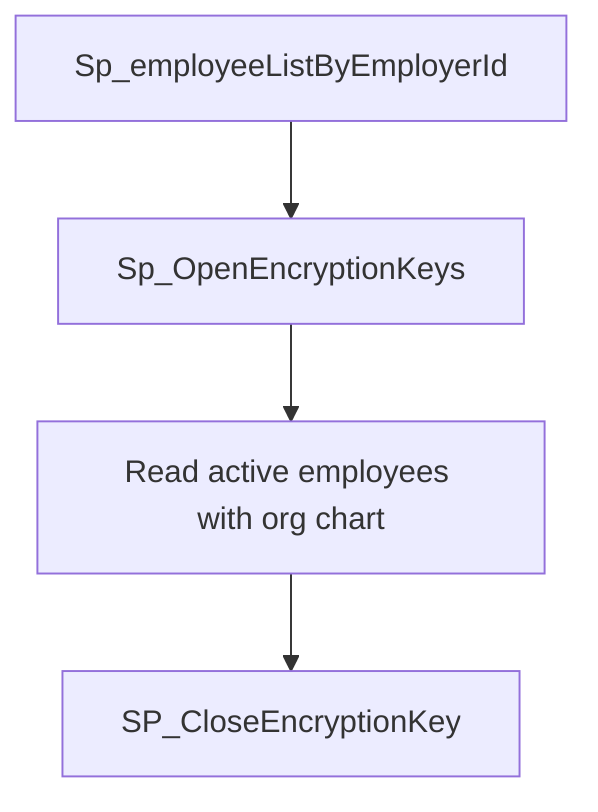

# Sp_employeeListByEmployerId

## What it does

Opens encryption keys, returns active employees for one employer who also have an org-chart row, with display name from `Fn_GetEmployeeName` and employment number from `TEmployeeInfo`, then closes encryption keys. Charts Setup uses the list for the employee multi-select / select.

## Parameters

| Name | Direction | What it is for |
|---|---|---|
| `@pEmployerid` | in | Employer id filter (`varchar(5000)` compared to `TEmployee.Employerid`) |

## Call sequence

## Callers

No other procedure or function calls this object. App caller: `dashBoardDAL.GetEmployeeListByOrgSetupCharts` from Charts Setup (`SetupCharts.aspx`).

## Nested

| Object | Kind | When | Page |
|---|---|---|---|
| `Sp_OpenEncryptionKeys` | procedure | before the select | [Sp_OpenEncryptionKeys](/docs/database/hrms/Sp_OpenEncryptionKeys) |
| `Fn_GetEmployeeName` | function | once per returned employee | [Fn_GetEmployeeName](/docs/database/hrms/Fn_GetEmployeeName) |
| `SP_CloseEncryptionKey` | procedure | after the select | [SP_CloseEncryptionKey](/docs/database/hrms/SP_CloseEncryptionKey) |

## Steps

In `HRMS-DATABASE/HRMS/STOREPROCEDURE/Sp_employeeListByEmployerId.sql`:

1. Execute `Sp_OpenEncryptionKeys`.
2. Select `EmployeeId`, `Fn_GetEmployeeName(EmployeeId)` as `FullName`, and `EmploymentNumber` from `TEmployee`, `TEmployeeInfo`, and `TORGChart` where the employee is active, the three tables share `EmployeeId`, and `TEmployee.Employerid = @pEmployerid`. Order by `EmployeeId`.
3. Execute `SP_CloseEncryptionKey`.

## Tables

| Table | Read or write |
|---|---|
| `dbo.TEmployee` | read |
| `dbo.TEmployeeInfo` | read |
| `dbo.TORGChart` | read |

## Flow

