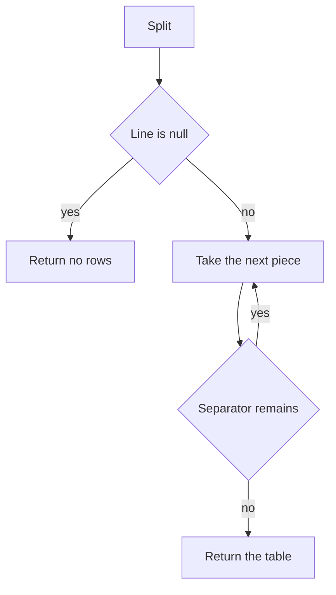

# Split

## What it does

Splits one string into a table of trimmed pieces. The default separator is a comma. A null input returns no rows. Each piece is one row with an identity `Id` and the text in `Data`.

## Parameters

| Name | Direction | What it is for |
|---|---|---|
| `@Line` | in | Text to split |
| `@SplitOn` | in | Separator. Default `,` |

The function returns a table of `Id` and `Data`.

## Call sequence

Calls no other procedures or functions.

## Callers

`STOREPROCEDURE` contains more than 200 scripts that call `dbo.Split`. The rows below are the Setup Masters procedures written with this page.

| Object | Kind | Page |
|---|---|---|
| `SP_AdminMstr_AddWeeklyOff` | procedure | [SP_AdminMstr_AddWeeklyOff](/docs/database/hrms/SP_AdminMstr_AddWeeklyOff) |
| `SP_AdminMstr_AddEmploymentType` | procedure | [SP_AdminMstr_AddEmploymentType](/docs/database/hrms/SP_AdminMstr_AddEmploymentType) |

## Nested

Calls no other procedures or functions.

## Steps

1. Return immediately when `@Line` is null (`Split.sql`).
2. Find the next separator with `CHARINDEX`.
3. Insert the trimmed substring into the return table.
4. Repeat until no separator remains, then insert the last piece.

## Tables

The function writes only its table-valued return. It does not read or write a permanent table.

## Flow

