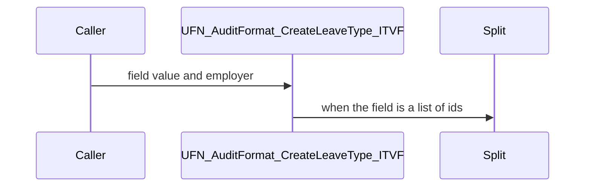
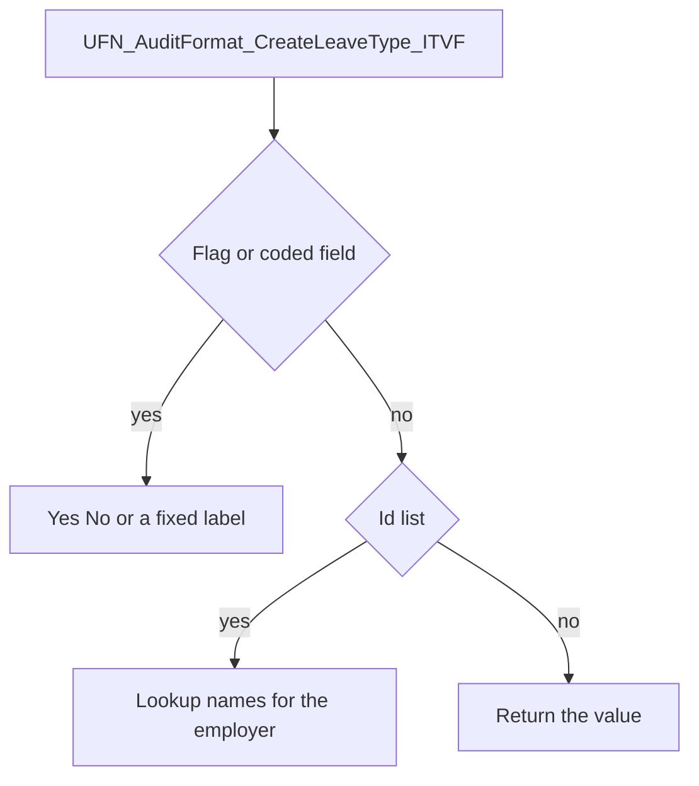

# UFN_AuditFormat_CreateLeaveType_ITVF

## What it does

Inline table function. Returns one column, `FormattedValue`, for a leave-type audit field. Flags become Yes or No, dates become `dd-mm-yyyy`, and id lists become names from the employer's master tables. Any field name that is not listed is returned unchanged.

## Parameters

| Name | Direction | What it is for |
|---|---|---|
| `@FieldName` | in | Column name on the change detail, compared in upper case. |
| `@Value` | in | Raw old or new value. |
| `@EmployerId` | in | Organisation used by the name lookups. |

## Call sequence

## Callers

Procedures and functions whose live statements invoke this object. Views are omitted.

| Object | Kind | Page |
|---|---|---|
| `SP_AdminSCCT_GetChangesForApproval` | procedure | [SP_AdminSCCT_GetChangesForApproval](/docs/database/hrms/SP_AdminSCCT_GetChangesForApproval) |

## Nested

| Object | Kind | When | Page |
|---|---|---|---|
| `Split` | function | business unit, location, grade, calendar, employment type, marital status, and option lists | [Split](/docs/database/hrms/Split) |

`STRING_SPLIT` is used for `CLUBEWITHLEAVECODE` and is a built-in.

## Steps

From `HRMS-DATABASE/HRMS/FUNCTIONS/UFN_AuditFormat_CreateLeaveType_ITVF.sql`.

1. `ISACTIVE` becomes `Y` or `N`. A long list of bit flags becomes `Yes` or `No`. `CurrentYearNegativeBalanceAllowed` becomes Allowed or Not Allowed. `IsLeaveTypeCompOff` maps `Y` and `N`.
2. `AllowSingleDayLeave` and `AllowMultipleDaysLeave` become Yes, or No for every other value.
3. `StartPeriod` is formatted as a date with `-` separators. Gender, document requirement, pullback applicable type, threshold count mode, event key, and threshold day fields have their own text maps.
4. `BusinessUnit`, `LocationId`, `GradeId`, `Calendar`, and the employee-status fields split `@Value` on `|` and look up names for `@EmployerId`. `MaritalStatusIds` and the intervening and salary-slip option fields split on `,`. `CLUBEWITHLEAVECODE` splits on `|` and joins `TLeaveTypeMaster.LeaveCode` where `IsDelete = 0`.
5. Anything else returns `@Value`.

## Tables

| Table | Read or write |
|---|---|
| `TOrgHierarchyDetails` | read |
| `TLocation` | read |
| `TGrade` | read |
| `TCalendarMaster` | read |
| `TMEmploymentTypes` | read |
| `TLeaveTypeMaster` | read |
| `TMaritalStatus` | read |

## Flow

