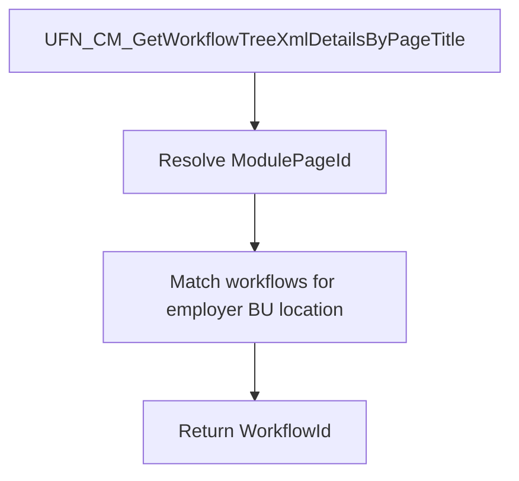

# UFN_CM_GetWorkflowTreeXmlDetailsByPageTitle

## What it does

Table-valued function that returns matching `WorkflowId` values for a module page title, employer, and employee (business unit / location aware, with optional partial workflow via `TCustomerSettings`). Travel & Expense replay and See All Updates call this through synonyms in the T&E database.

## Parameters

| Name | Direction | What it is for |
|---|---|---|
| `@PageTitle` | in | Module page name (e.g. ExpenseRequest) |
| `@Employerid` | in | Employer |
| `@EmployeeID` | in | Subject employee for BU/location |

## Call sequence

Calls no other procedures. Reads workflow / module page / employee info tables.

## Callers

| Object | Kind | Page |
|---|---|---|
| `SP_TNE_GetRequestStatusForSeeAllUpdatesNew` | procedure | [SP_TNE_GetRequestStatusForSeeAllUpdatesNew](/docs/database/hrms-travelnexpense/SP_TNE_GetRequestStatusForSeeAllUpdatesNew) |
| `SP_TNE_ReplayStalledRequest` | procedure | [SP_TNE_ReplayStalledRequest](/docs/database/hrms-travelnexpense/SP_TNE_ReplayStalledRequest) |

Additional callers exist across HRMS modules beyond this Expense Requests pass.

## Nested

None.

## Steps

1. Script is `UFN_CM_GetWorkflowTreeXmlDetailsByPageTitle.sql`.
2. Read `AllowPartialWorkflow` from `TCustomerSettings`; resolve employee BU/location.
3. Map `@PageTitle` to `TModulePages.ModulePageId` (with WFH title remap).
4. Select matching workflow ids into the return table based on employer and location/BU rules in the function body.

## Tables

| Table | Read or write |
|---|---|
| `TCustomerSettings` | read |
| `TEmployeeInfo` | read |
| `TModulePages` | read |
| Workflow management / details tables in body | read |

## Unresolved calls

None.

## Flow

