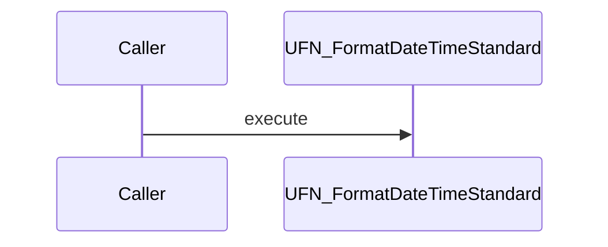
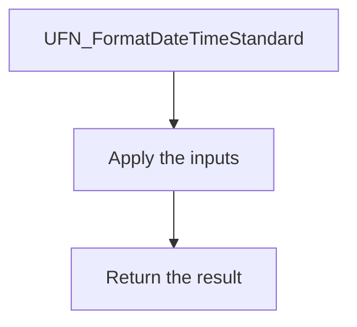

# UFN_FormatDateTimeStandard

## What it does

Helper called by a Home dashboard procedure. It reads its inputs and returns that result to its caller.

## Parameters

| Name | Direction | What it is for |
|---|---|---|
| `@DateValue` | in | Input used by this procedure (`DATETIME`) |
| `@DisplayType` | in | Input used by this procedure (`VARCHAR(50)`) |

## Call sequence

## Callers

| Object | Kind | Page |
|---|---|---|
| `SP_AddCompOffRequest` | procedure | No page yet |
| `SP_AdminLM_TruncateLeave` | procedure | No page yet |
| `SP_AdminLM_TruncateLeave_EmailAlert` | procedure | No page yet |
| `SP_AdminMstr_UpdHoliday` | procedure | No page yet |
| `SP_CM_ApproveWorkFlowRequest` | procedure | No page yet |
| `SP_DB_EmployeeAttendanceDetails` | procedure | [SP_DB_EmployeeAttendanceDetails](/docs/database/hrms/SP_DB_EmployeeAttendanceDetails) |
| `SP_GetDataForEmailNotIfication` | procedure | No page yet |
| `Sp_GetEmpAttendanceDetails` | procedure | No page yet |
| `SP_GetHomePagePEndingDetailsByMe` | procedure | No page yet |
| `SP_GetTeamAttendanceDetailsNew` | procedure | [SP_GetTeamAttendanceDetailsNew](/docs/database/hrms/SP_GetTeamAttendanceDetailsNew) |
| `SP_LA_GetAllNotificationToReassign` | procedure | No page yet |
| `SP_LA_GetLeaveDetails` | procedure | No page yet |
| `SP_LA_Validate_HourlyBasedLeave` | procedure | No page yet |
| `SP_RPT_Leave_ByDate` | procedure | No page yet |
| `sp_vw_AttendanceRegularizationSummaryReports` | procedure | No page yet |
| `SP_vw_LeaveLedgerReport` | procedure | No page yet |
| `USP_AdminLM_GetLeaveTypeDetById` | procedure | No page yet |
| `USP_AdminMstr_Holiday_Validation` | procedure | No page yet |
| `USP_API_Holiday_List` | procedure | No page yet |
| `USP_Approval_LeavePolicyChanges_GetByChangeRequestId` | procedure | No page yet |
| `USP_AR_LinkedRequests_Get` | procedure | No page yet |
| `USP_AttendanceOverTime_Deactivate` | procedure | No page yet |
| `USP_AttendanceOverTime_Employee_SaveUpdate` | procedure | No page yet |
| `USP_AttendanceOverTime_Notification_List` | procedure | No page yet |
| `USP_AttendanceOverTime_Notification_ModalView` | procedure | No page yet |
| `USP_AttendanceOverTime_Process` | procedure | No page yet |
| `USP_AttendanceOverTime_Pullback` | procedure | No page yet |
| `USP_AttendanceOverTime_Report` | procedure | No page yet |
| `USP_AttendanceOverTimeRule_History_List` | procedure | No page yet |
| `USP_AttendanceOverTimeRule_List` | procedure | No page yet |
| `USP_ClaimCompOff_Report` | procedure | No page yet |
| `USP_ClaimEventLeave_EmailData_Get` | procedure | No page yet |
| `USP_ClaimEventLeave_GetAvailableForApply` | procedure | No page yet |
| `USP_ClaimEventLeave_Notification_ModalView` | procedure | No page yet |
| `USP_ClaimEventLeave_Notification_Pullback_Approved_List` | procedure | No page yet |
| `USP_ClaimEventLeave_Notification_Pullback_ApprovedAll_List` | procedure | No page yet |
| `USP_ClaimEventLeave_Notification_Pullback_Pending_List` | procedure | No page yet |
| `USP_ClaimEventLeave_Notification_Request_Approved_List` | procedure | No page yet |
| `USP_ClaimEventLeave_Notification_Request_ApprovedAll_List` | procedure | No page yet |
| `USP_ClaimEventLeave_Notification_Request_Pending_List` | procedure | No page yet |
| `USP_ClaimEventLeave_Pullback` | procedure | No page yet |
| `USP_ClaimEventLeave_RequestList` | procedure | No page yet |
| `USP_ClaimEventLeave_Validate` | procedure | No page yet |
| `USP_ClaimLocum` | procedure | No page yet |
| `USP_ClaimLocum_List` | procedure | No page yet |
| `USP_ClaimLocum_Notification_Cancellation_Details` | procedure | No page yet |
| `USP_ClaimLocum_Notification_ModalView` | procedure | No page yet |
| `USP_ClaimLocum_Notification_Request_Details` | procedure | No page yet |
| `USP_ClaimLocum_PullBack` | procedure | No page yet |
| `USP_ClaimLocum_Report` | procedure | No page yet |
| `USP_ClaimLocum_SaveUpdate` | procedure | No page yet |
| `USP_ClaimOT_Detail_Report` | procedure | No page yet |
| `USP_ClaimOT_Employee_AutoSaveUpdate` | procedure | No page yet |
| `USP_ClaimOT_EmployeeAttendaceInformation` | procedure | No page yet |
| `USP_ClaimOT_List` | procedure | No page yet |
| `USP_ClaimOT_ProcessPendingRequests` | procedure | No page yet |
| `USP_ClaimOT_Rule_History_List` | procedure | No page yet |
| `USP_ClaimOT_Rule_List` | procedure | No page yet |
| `USP_ClaimOT_SaveUpdate` | procedure | No page yet |
| `USP_ClaimOT_Summary_Report` | procedure | No page yet |
| `USP_ClaimOT_ValidateForApprovalOrRejection` | procedure | No page yet |
| `USP_ClaimOT_ValidateRequest` | procedure | No page yet |
| `usp_ClaimOverTime` | procedure | No page yet |
| `USP_ClaimPH_AR_Link_Deactivate` | procedure | No page yet |
| `USP_ClaimPH_List` | procedure | No page yet |
| `USP_ClaimPH_Notification_ModalView` | procedure | No page yet |
| `USP_ClaimPH_PullBack` | procedure | No page yet |
| `USP_ClaimPH_Report` | procedure | No page yet |
| `USP_ClaimPH_SaveUpdate` | procedure | No page yet |
| `USP_CompOff_SaveRequest` | procedure | No page yet |
| `USP_EmailNotificaion_ClaimPH` | procedure | No page yet |
| `USP_EmployerOTSettings_List` | procedure | No page yet |
| `USP_EmployerOTSettingsHistory_List` | procedure | No page yet |
| `USP_FreezeAttendance_GetDetails` | procedure | No page yet |
| `USP_FreezeAttendance_List` | procedure | No page yet |
| `USP_FreezeAttendance_Status_History` | procedure | No page yet |
| `USP_Get_Employees_ActualWorkedMinutesLeaves` | procedure | No page yet |
| `USP_LA_Approved_All_AR_Cancellation` | procedure | No page yet |
| `USP_LA_Approved_All_AR_Request` | procedure | No page yet |
| `USP_LA_Approved_All_ClaimLocum_Cancellation` | procedure | No page yet |
| `USP_LA_Approved_All_ClaimLocum_Request` | procedure | No page yet |
| `USP_LA_Approved_All_ClaimOT_Request` | procedure | No page yet |
| `USP_LA_Approved_All_ClaimPH_Cancellation` | procedure | No page yet |
| `USP_LA_Approved_All_ClaimPH_Request` | procedure | No page yet |
| `USP_LA_Approved_All_CompOff_Request_ByEmployee` | procedure | No page yet |
| `USP_LA_Approved_All_CompOffCreditRequest` | procedure | No page yet |
| `USP_LA_Approved_All_Leave_Cancellation` | procedure | No page yet |
| `USP_LA_Approved_All_Leave_Encashment` | procedure | No page yet |
| `USP_LA_Approved_All_Leave_Request` | procedure | No page yet |
| `USP_LA_Approved_All_OptionalHoliday_Cancellation` | procedure | No page yet |
| `USP_LA_Approved_All_OptionalHoliday_Request` | procedure | No page yet |
| `USP_LA_Approved_All_PreApprovalOT_Request_Details` | procedure | No page yet |
| `USP_LA_Approved_All_WFH_Cancellation` | procedure | No page yet |
| `USP_LA_Approved_All_WFH_Request` | procedure | No page yet |
| `USP_LA_Approved_ClaimLocum_Request` | procedure | No page yet |
| `USP_LA_Approved_ClaimOT_Request` | procedure | No page yet |
| `USP_LA_Employee_Leave_CustomReport` | procedure | No page yet |
| `USP_LA_Employee_Leave_Report` | procedure | No page yet |
| `USP_LA_LeaveEvent_GetByID` | procedure | No page yet |
| `USP_LA_LeaveType_GetById` | procedure | No page yet |
| `USP_LA_LeaveType_Policy_Approval_GetByChangeRequestId` | procedure | No page yet |
| `USP_LA_LeaveType_Policy_GetList` | procedure | No page yet |
| `USP_LA_LeaveType_Policy_GetPendingApprovalChanges` | procedure | No page yet |
| `USP_LA_LeaveType_Policy_History_GetList` | procedure | No page yet |
| `USP_LA_Notification_Request_Pending_ByMe_List` | procedure | No page yet |
| `USP_LA_Status_History_AttendanceOverTime` | procedure | No page yet |
| `USP_LA_ValidateEventLeaveClaimUsage` | procedure | No page yet |
| `USP_LA_ValidateLeaveRequest` | procedure | No page yet |
| `USP_LE_EmailNotification` | procedure | No page yet |
| `USP_LE_Encashment_Notification_List` | procedure | No page yet |
| `USP_LE_List` | procedure | No page yet |
| `USP_LE_Report` | procedure | No page yet |
| `USP_Leave_Policy_GetChangesForApproval` | procedure | No page yet |
| `USP_Leave_Policy_History_List` | procedure | No page yet |
| `USP_Leave_Policy_List` | procedure | No page yet |
| `USP_LeaveCFEncash_ProcessBalances` | procedure | No page yet |
| `USP_LeaveCFEncash_SendNotifications` | procedure | No page yet |
| `USP_LeaveRequest_GetHistory` | procedure | No page yet |
| `USP_LeaveRequest_Notification_ModalView` | procedure | No page yet |
| `USP_OH_ValidateRequest` | procedure | No page yet |
| `USP_OT_AR_Link_Deactivate` | procedure | No page yet |
| `USP_OT_AR_Link_GetForApproval` | procedure | No page yet |
| `USP_OT_Claim_Auto` | procedure | No page yet |
| `USP_OT_Claim_DetailsPopup_Get` | procedure | No page yet |
| `USP_OT_Claim_GetAttendanceForClaim` | procedure | No page yet |
| `USP_OT_Claim_List` | procedure | No page yet |
| `USP_OT_Claim_Manual` | procedure | No page yet |
| `USP_OT_Claim_NotificationData_Get` | procedure | No page yet |
| `USP_OT_Claim_Process` | procedure | No page yet |
| `USP_OT_Claim_ThresholdAlert_EmailData_Get` | procedure | No page yet |
| `USP_OT_Claim_Validate` | procedure | No page yet |
| `USP_OT_Claim_Validate_ApprovedDuration` | procedure | No page yet |
| `USP_OT_Deactivate` | procedure | No page yet |
| `USP_OT_Deviation_List` | procedure | No page yet |
| `USP_OT_Deviation_Unsubmitted_List` | procedure | No page yet |
| `USP_OT_Notification_Claim_Approved_List` | procedure | No page yet |
| `USP_OT_Notification_Claim_ApprovedAll_List` | procedure | No page yet |
| `USP_OT_Notification_Claim_Pending_List` | procedure | No page yet |
| `USP_OT_Notification_Deviation_Approved_List` | procedure | No page yet |
| `USP_OT_Notification_Deviation_Pending_List` | procedure | No page yet |
| `USP_OT_Notification_List` | procedure | No page yet |
| `USP_OT_Notification_ModalView` | procedure | No page yet |
| `USP_OT_Notification_Planned_Approved_List` | procedure | No page yet |
| `USP_OT_Notification_Planned_ApprovedAll_List` | procedure | No page yet |
| `USP_OT_Notification_Planned_Pending_List` | procedure | No page yet |
| `USP_OT_OTRequest_CompletedOT` | procedure | No page yet |
| `USP_OT_OTRequest_List` | procedure | No page yet |
| `USP_OT_OTRequest_MyTeamsOT` | procedure | No page yet |
| `USP_OT_OTRequest_Notification_List` | procedure | No page yet |
| `USP_OT_OTRequest_OverTime_Report` | procedure | No page yet |
| `USP_OT_OTRequest_PreApproval_Report` | procedure | No page yet |
| `USP_OT_OTRequest_PreApprovalOT_Updates` | procedure | No page yet |
| `USP_OT_OTRequest_UpcomingOT` | procedure | No page yet |
| `USP_OT_OTRequest_Update_ReminderNotification` | procedure | No page yet |
| `USP_OT_Planned_CompletedOT` | procedure | No page yet |
| `USP_OT_Planned_List` | procedure | No page yet |
| `USP_OT_Planned_Reminder_EmailData_Get` | procedure | No page yet |
| `USP_OT_Planned_Reminder_Recalculate` | procedure | No page yet |
| `USP_OT_Planned_UpcomingOT` | procedure | No page yet |
| `USP_OT_Planned_Validate` | procedure | No page yet |
| `USP_OT_Planned_Validate_ApprovedDuration` | procedure | No page yet |
| `USP_OT_Popup_Claim_Details_Get` | procedure | No page yet |
| `USP_OT_Popup_ShiftAndRuleDetails_Get` | procedure | No page yet |
| `USP_OT_Rule_History_List` | procedure | No page yet |
| `USP_OT_Rule_List` | procedure | No page yet |
| `USP_OT_SendThresholdAlertEmail` | procedure | No page yet |
| `USP_OT_Settings_History_List` | procedure | No page yet |
| `USP_OT_Settings_List` | procedure | No page yet |
| `USP_ReasonCommentsConfig_GetByModule` | procedure | No page yet |
| `USP_Reassign_GetCandidateEligibilityDetail` | procedure | No page yet |
| `USP_Reassign_List` | procedure | No page yet |
| `USP_Report_Leave_ClaimEventLeave` | procedure | No page yet |
| `USP_Report_Leave_LeaveEncashmment` | procedure | No page yet |
| `USP_Report_Leave_LeaveLedger` | procedure | No page yet |
| `USP_Report_Leave_LeaveRange` | procedure | No page yet |
| `USP_Report_Leave_LeaveReport` | procedure | No page yet |
| `USP_Report_Leave_PendingApprovals` | procedure | No page yet |
| `USP_Report_TimeAttendance_OptionalHoliday` | procedure | No page yet |
| `USP_Report_TimeAttendance_OverTime_Detail` | procedure | No page yet |
| `USP_Report_TimeAttendance_Overtime_Planned` | procedure | No page yet |
| `USP_Report_TimeAttendance_OverTime_Summary` | procedure | No page yet |
| `USP_Roster_Template_List` | procedure | No page yet |
| `USP_RosterPattern_Get` | procedure | No page yet |
| `USP_RosterPattern_Template_List` | procedure | No page yet |
| `USP_TLicence_List` | procedure | No page yet |
| `USP_TLicenceHistory_List` | procedure | No page yet |
| `usp_UVW_AttendanceOverTime` | procedure | No page yet |
| `usp_UVW_OT_OTRequest_PreApproval_Report` | procedure | No page yet |
| `USP_WFH_ValidateRequest` | procedure | No page yet |

## Nested

This object does not execute another procedure or user-defined function.

## Steps

In `HRMS-DATABASE/HRMS/FUNCTIONS/UFN_FormatDateTimeStandard.sql`:

1. Return the result set to the caller.

## Tables

No permanent table is read or written. The result comes from parameters, functions, or table variables.

## Flow

