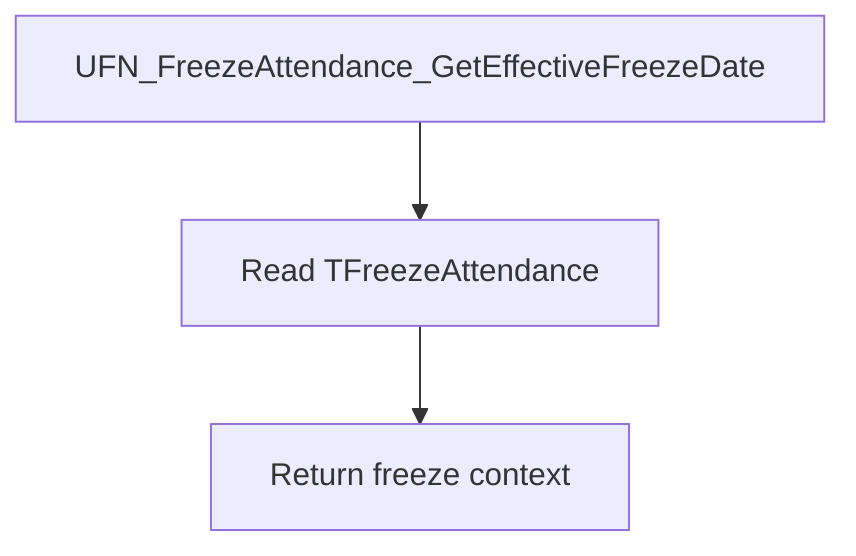

# UFN_FreezeAttendance_GetEffectiveFreezeDate

## What it does

Returns the currently enforced freeze context for an employer (used when My Dashboard AR rejection lists need freeze awareness).

## Parameters

| Name | Direction | What it is for |
|---|---|---|
| `@Employerid` | in | Employer whose freeze row is read |
| `@CheckType` | in | Freeze check mode (`CHAR(1)`) |

## Call sequence

Calls no other procedures or functions.

## Callers

| Object | Kind | Page |
|---|---|---|
| `SP_LA_GetAttendanceForRejection` | procedure | [SP_LA_GetAttendanceForRejection](/docs/database/hrms/SP_LA_GetAttendanceForRejection) |

## Nested

Calls no other procedures or functions.

## Steps

1. Read `HRMS-DATABASE/HRMS/FUNCTIONS/UFN_FreezeAttendance_GetEffectiveFreezeDate.sql`.
2. Look up `TFreezeAttendance` for `@Employerid` using `@CheckType`.
3. Return the effective freeze date/context for callers that gate AR actions.

## Tables

| Table | Read or write |
|---|---|
| `dbo.TFreezeAttendance` | read |

## Flow

