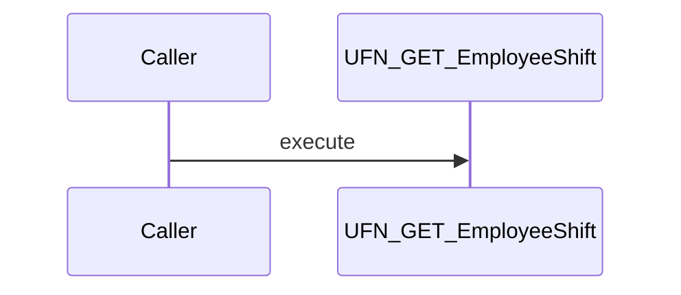
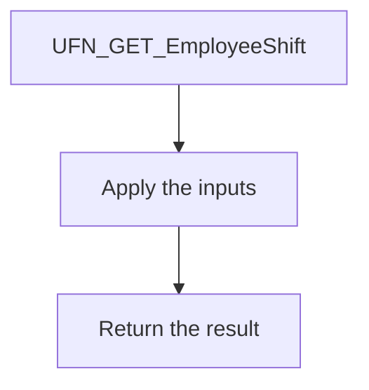

# UFN_GET_EmployeeShift

## What it does

Helper called by a Home dashboard procedure. It reads tEmployeeinfo, tcustomersettings, tSHiftGroupMaster, tEmployeeRoasterDetails and returns that result to its caller.

## Parameters

| Name | Direction | What it is for |
|---|---|---|
| `@lEmployeeid` | in | Input used by this procedure (`INT`) |

## Call sequence

## Callers

| Object | Kind | Page |
|---|---|---|
| `SP_CM_GetEmployeeFullInformation` | procedure | No page yet |
| `SP_CM_GetEmployeeSummaryData` | procedure | No page yet |
| `Sp_DailyAttendanceReport_New` | procedure | No page yet |
| `sp_DailyAttendanceReport_Performance` | procedure | No page yet |
| `SP_DB_EmployeeAttendanceDetails` | procedure | [SP_DB_EmployeeAttendanceDetails](/docs/database/hrms/SP_DB_EmployeeAttendanceDetails) |
| `SP_DB_EmployeeAttendanceDetails_HT` | procedure | No page yet |
| `SP_DB_EmployeeAttendanceFromEmailDetails` | procedure | No page yet |
| `SP_DB_EmployeeDayWiseAttendanceDetails` | procedure | No page yet |
| `SP_EmployeeInformation_Shift` | procedure | No page yet |
| `SP_EmployeeInformation_Shift_GlobalFilter` | procedure | No page yet |
| `Sp_EMPMD_GetEmpHistory` | procedure | No page yet |
| `SP_EMPMD_GetEmpSummaryData` | procedure | No page yet |
| `SP_Getall_week_holiday_optional_workinghours` | procedure | No page yet |
| `SP_GetAllNotification_TotalHrs` | procedure | No page yet |
| `SP_GetAttendancetransaction` | procedure | No page yet |
| `Sp_GetEmpAttendanceDetails_DashBoard` | procedure | No page yet |
| `Sp_GetEmpAttendanceDetails_DashBoardCnt` | procedure | No page yet |
| `SP_GetEmployeeFullInformation` | procedure | No page yet |
| `Sp_GetEmployeeFutureInfo` | procedure | No page yet |
| `Sp_GetEmployeeHistory` | procedure | No page yet |
| `SP_GetEmployeeOFficialHistoryData` | procedure | No page yet |
| `SP_GetEmployeeSummaryData` | procedure | No page yet |
| `SP_GetHomePagePEndingDetailsByMe` | procedure | No page yet |
| `Sp_GetSpecificFutureEmployeeinfo` | procedure | No page yet |
| `SP_Ins_Upd_TDailyRegister` | procedure | No page yet |
| `SP_LeaveAttendance_DashBoard` | procedure | No page yet |
| `SP_LOG_UserEmployee` | procedure | No page yet |
| `SP_SEP_AutoDeactivateEmployee` | procedure | No page yet |
| `SP_SEP_DeActivateEmployee` | procedure | No page yet |
| `SP_SEP_DeActivateEmployee_BY_ID` | procedure | No page yet |
| `SP_SEP_DeActivateEmployeeBKP03052025` | procedure | No page yet |
| `SP_SEP_DeActivateEmployeeWithAssets` | procedure | No page yet |
| `SP_SEP_Update_LastWorkingDatePast` | procedure | No page yet |
| `SP_UserEmployee` | procedure | No page yet |
| `SP_vw_EmployeeFullInfoReports` | procedure | No page yet |
| `ufn_CalculateTotalCapacity` | function | No page yet |
| `USP_DayWiseAttendance` | procedure | No page yet |
| `USP_EmployeeFullInfoReports` | procedure | No page yet |
| `USP_GET_RPI_AttendenceNotificationCount` | procedure | No page yet |
| `USP_GET_RPI_AttendenceNotificationCount_1182024` | procedure | No page yet |
| `USP_GetEmployeeLeaveAttendanceDetails` | procedure | No page yet |
| `USP_GetEmployeeLeaveAttendanceDetails_HT` | procedure | No page yet |
| `USP_GetHomePagePEndingDetailsByMe_Count` | procedure | No page yet |
| `USP_LA_Notification_Request_Pending_ByMe_Count` | procedure | No page yet |
| `USP_LA_Notification_Request_Pending_ByMe_List` | procedure | No page yet |
| `USP_LeaveNotifications_Count` | procedure | No page yet |
| `USP_OT_PreApproved_DayWise_Report` | procedure | No page yet |
| `USP_Report_TimeAttendance_Overtime_DayWise` | procedure | No page yet |
| `USP_vw_AssignedEmployeeReport` | procedure | No page yet |
| `usp_vw_EmployeeCreation` | procedure | No page yet |

## Nested

This object does not execute another procedure or user-defined function.

## Steps

In `HRMS-DATABASE/HRMS/FUNCTIONS/UFN_GET_EmployeeShift.sql`:

1. Read `tEmployeeinfo`, `tcustomersettings`, `tSHiftGroupMaster`, `tEmployeeRoasterDetails`, `tEmployeeRoaster`, `TEmployeeInfoHistory`.
2. Return the result set to the caller.

## Tables

| Table | Read or write |
|---|---|
| `tEmployeeinfo` | read |
| `tcustomersettings` | read |
| `tSHiftGroupMaster` | read |
| `tEmployeeRoasterDetails` | read |
| `tEmployeeRoaster` | read |
| `TEmployeeInfoHistory` | read |

## Flow

