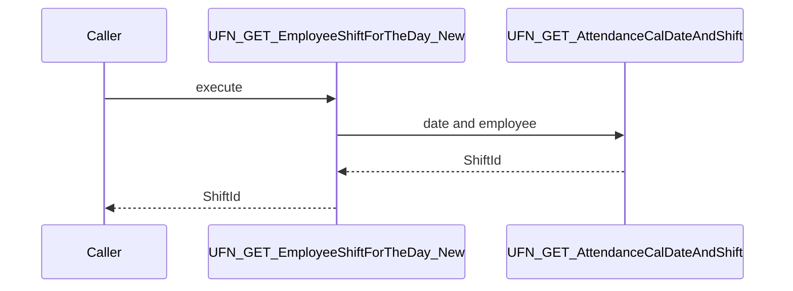
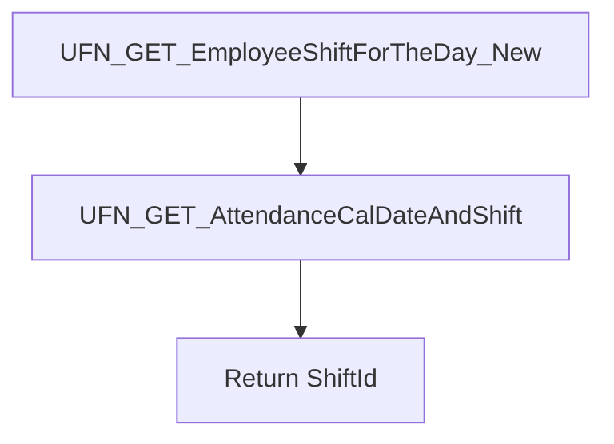

# UFN_GET_EmployeeShiftForTheDay_New

## What it does

Returns the `ShiftId` for an employee on a given date. The live body only reads `ShiftId` from `UFN_GET_AttendanceCalDateAndShift` for that date and employee. Older roster / auto-shift / punch-based branches remain in the script as comments. Called from `SP_LA_SOL_LeaveDetails_ForExit` (and many attendance / comp-off procedures) to pick the shift whose start/end times form the SOL exit window.

## Parameters

| Name | Direction | What it is for |
|---|---|---|
| `@lEmployeeid` | in | Employee whose shift is resolved |
| `@lShiftAllocatedDate` | in | Calendar date for the shift |
| `@lEmployerID` | in | Employer id — **not used** in the active (uncommented) body |

## Call sequence

## Callers

| Object | Kind | Page |
|---|---|---|
| `SP_LA_SOL_LeaveDetails_ForExit` | procedure | [SP_LA_SOL_LeaveDetails_ForExit](/docs/database/hrms/SP_LA_SOL_LeaveDetails_ForExit) |
| `SP_AddCompOffRequest` | procedure | No page yet |
| `SP_AddCompOffRequest_Mobile` | procedure | No page yet |
| `Sp_CreateAutoCompOffCreditRequest` | procedure | No page yet |
| `USP_GetEligibleCompOff_Duration` | procedure | No page yet |
| `USP_CompOff_GetEligibleDuration` | procedure | No page yet |

Additional callers may exist outside this AccessPoint pass.

## Nested

| Object | Kind | Role |
|---|---|---|
| `UFN_GET_AttendanceCalDateAndShift` | function | Source of `ShiftId` for the date |

## Steps

1. Script is `HRMS-DATABASE/HRMS/FUNCTIONS/UFN_GET_EmployeeShiftForTheDay_New.sql`.
2. Declare `@ShiftId`.
3. `SELECT @ShiftId = ShiftId FROM dbo.UFN_GET_AttendanceCalDateAndShift(@lShiftAllocatedDate, @lEmployeeID)`.
4. Return `@ShiftId` (may be NULL if the nested function returns no row).
5. Large commented block documents a previous IsShowShiftRoaster / roster / in-punch path that is not executed.

## Tables

| Table | Read or write |
|---|---|
| *(none directly in active body)* | — |

Active path reads only through `UFN_GET_AttendanceCalDateAndShift`. Commented branches would have touched `tcustomersettings`, `TEmployeeinfo`, `TEmployeeInfoHistory`, `TEmployeeRoasterDetails`, `TAttendanceTransaction`, `tSHiftGroupMaster`, `tShiftMaster`, and `tShiftgroupMapping`.

## Unresolved calls

None in the active body. Nested `UFN_GET_AttendanceCalDateAndShift` is a second nesting level from AccessPoint direct SPs and was not given a new page in this pass.

## Flow

