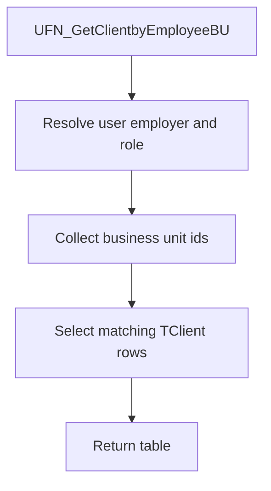

# UFN_GetClientbyEmployeeBU

## What it does

Table-valued function that returns the set of clients an employee may see, based on the user’s employer (including global-access employer list) and business units from `TUSerPagesMapping` / `TRolePagesMapping`, joined through `TClientBusinessUnitMapping` (or all clients under the root employer when no BU list is set).

## Parameters

| Name | Direction | What it is for |
|---|---|---|
| `@EmployeeId` | in | Employee whose user/BU scope drives the client set |

## Call sequence

Calls no other procedures or functions.

## Callers

Procedures and functions that call this object.

| Object | Kind | Page |
|---|---|---|
| `Sp_GetAllLookupDetailsByEmployee` | procedure | [Sp_GetAllLookupDetailsByEmployee](/docs/database/hrms/Sp_GetAllLookupDetailsByEmployee) |

## Nested

Calls no other procedures or functions.

## Steps

1. Script is `HRMS-DATABASE/HRMS/FUNCTIONS/UFN_GetClientbyEmployeeBU.sql`.
2. Resolve user, role, employer, and optional global-access employer ids from `TUsers` / `TUserEmployee` / `tEmployerDetails`.
3. Collect business unit ids from user and role page mappings.
4. Return distinct clients from `TClient` for those employers, filtered by BU mapping or root-employer fallback.

## Tables

| Table | Read or write |
|---|---|
| `dbo.TUsers` | read |
| `dbo.TUserEmployee` | read |
| `dbo.tEmployerDetails` | read |
| `dbo.TUSerPagesMapping` | read |
| `dbo.TRolePagesMapping` | read |
| `dbo.TClient` | read |
| `dbo.TClientBusinessUnitMapping` | read |
| `dbo.TOrgHierarchyDetails` | read |

## Flow

