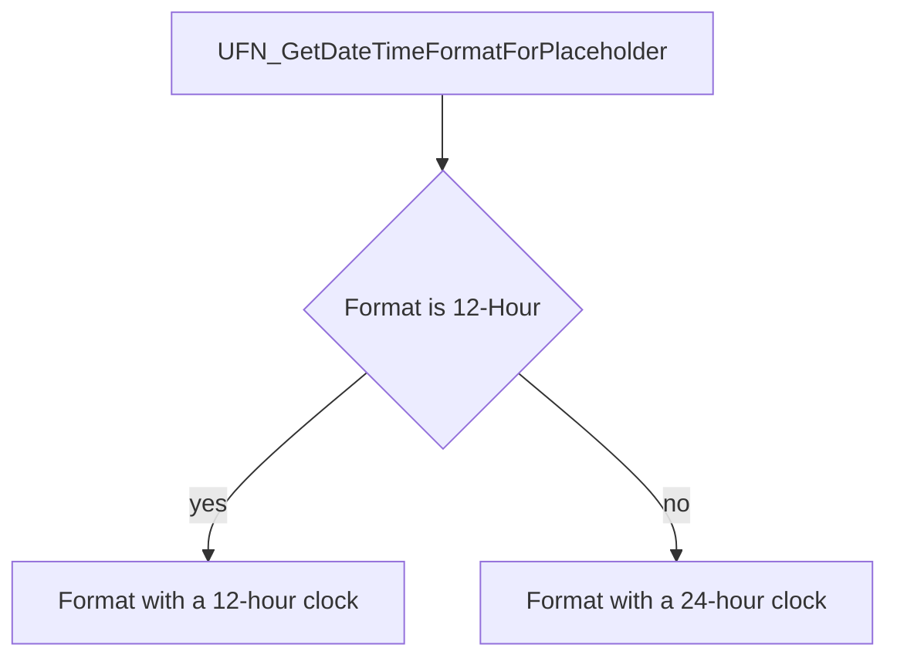

# UFN_GetDateTimeFormatForPlaceholder

## What it does

Formats a datetime as `dd-MMM-yyyy` plus a time. `@Format` `12-Hour` uses a 12-hour clock. Every other value, including null, uses a 24-hour clock.

## Parameters

| Name | Direction | What it is for |
|---|---|---|
| `@DateValue` | in | Datetime to format |
| `@Format` | in | `12-Hour` selects `hh`. Otherwise the format uses `HH` |

## Call sequence

Calls no other procedures or functions.

## Callers

Procedures whose statements invoke this function. Views are omitted.

| Object | Kind | Page |
|---|---|---|
| `USP_EmployeeAccessPermission_List` | procedure | [USP_EmployeeAccessPermission_List](/docs/database/hrms/USP_EmployeeAccessPermission_List) |
| `USP_EmployeeAccessPermission_History_List` | procedure | No page yet |
| `USP_TM_Task_Detail_By_TaskID` | procedure | No page yet |
| `USP_TM_TaskReport_List` | procedure | No page yet |
| `USP_TM_TaskList` | procedure | No page yet |
| `USP_TM_Notification_Tasks_List` | procedure | No page yet |
| `USP_TM_TaskChat_List` | procedure | No page yet |
| `USP_TM_My_Tasks` | procedure | No page yet |
| `USP_Report_Separation_ExitInterview` | procedure | No page yet |
| `USP_GetPendingTerminationDetail` | procedure | No page yet |
| `USP_FNF_Payment_List` | procedure | No page yet |
| `USP_EmailCommunication_List` | procedure | No page yet |
| `Sp_GetWhatsAppNotificationDetails` | procedure | No page yet |
| `usp_vw_ResignationApproved` | procedure | No page yet |
| `usp_vw_RRSofferSendForReview` | procedure | No page yet |

Recruitment Management reaches it through `USP_EmployeeAccessPermission_List`.

## Nested

Calls no other procedures or functions.

## Steps

1. When `@Format` is `12-Hour`, return `FORMAT(@DateValue, 'dd-MMM-yyyy hh:mm:ss')` (`UFN_GetDateTimeFormatForPlaceholder.sql`).
2. Otherwise return `FORMAT(@DateValue, 'dd-MMM-yyyy HH:mm:ss')`.

## Tables

The function reads no tables.

## Flow

