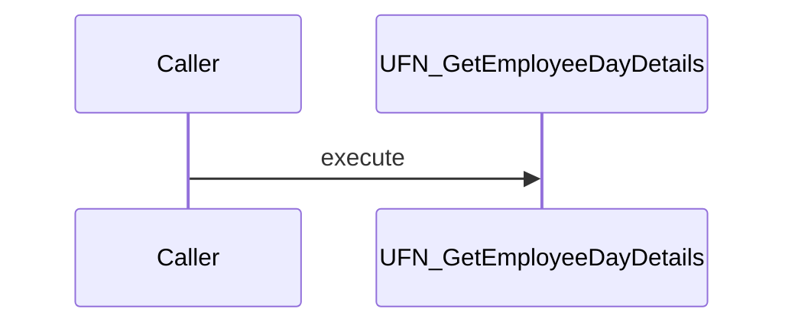
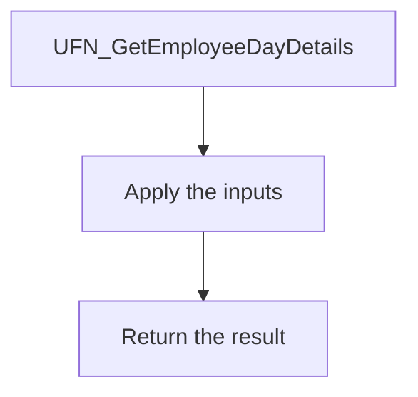

# UFN_GetEmployeeDayDetails

## What it does

Helper called by a Home dashboard procedure. It reads its inputs and returns that result to its caller.

## Parameters

| Name | Direction | What it is for |
|---|---|---|
| `@WeeklyOffCode` | in | Input used by this procedure (`INT`) |
| `@HolidayCode` | in | Input used by this procedure (`INT`) |

## Call sequence

## Callers

| Object | Kind | Page |
|---|---|---|
| `SP_DB_EmployeeAttendanceDetails` | procedure | [SP_DB_EmployeeAttendanceDetails](/docs/database/hrms/SP_DB_EmployeeAttendanceDetails) |
| `SP_DB_EmployeeAttendanceFromEmailDetails` | procedure | No page yet |
| `SP_DB_EmployeeDayWiseAttendanceDetails` | procedure | No page yet |
| `UFN_GetEmployeeDayStatus` | function | No page yet |
| `UFN_GetEmployeeDayStatus_DRN` | function | No page yet |
| `USP_Get_ManageRoasterHistory` | procedure | No page yet |
| `USP_GetEmployeeLeaveAttendanceDetails` | procedure | No page yet |
| `USP_InsertEmployeeRoaster` | procedure | No page yet |
| `USP_InsertEmployeeRoaster_AllTime` | procedure | No page yet |
| `USP_InsertEmployeeRoaster_AllTimeNo` | procedure | No page yet |
| `USP_LA_Validate_Leave_FromToDate` | procedure | No page yet |
| `USP_Roster_CreateEmployeeRoster` | procedure | No page yet |
| `USP_Roster_Process_AllTimeNo` | procedure | No page yet |
| `USP_Roster_Process_AllTimeYes` | procedure | No page yet |
| `USP_Roster_Process_Delta` | procedure | No page yet |
| `USP_Roster_Process_Template` | procedure | No page yet |
| `USP_Roster_Save` | procedure | No page yet |
| `USP_Roster_UpdateEmployeeRoster` | procedure | No page yet |
| `USP_RosterPattern_CreateEmployeeRoster` | procedure | No page yet |
| `USP_RosterPattern_CreateEmployeeRoster_Scheduler` | procedure | No page yet |
| `USP_Update_ManageRoaster` | procedure | No page yet |

## Nested

This object does not execute another procedure or user-defined function.

## Steps

In `HRMS-DATABASE/HRMS/FUNCTIONS/UFN_GetEmployeeDayDetails.sql`:

1. Return the result set to the caller.

## Tables

No permanent table is read or written. The result comes from parameters, functions, or table variables.

## Flow

