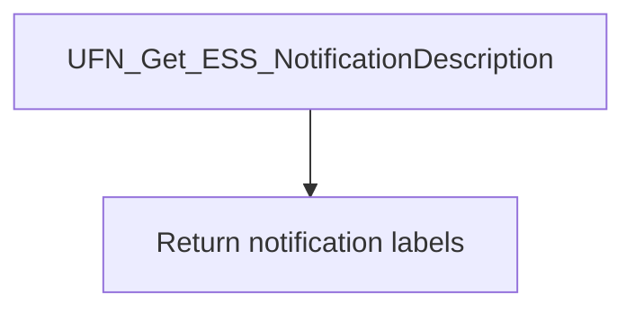

# UFN_Get_ESS_NotificationDescription

## What it does

Turns comma-separated notification codes into labels. R is Reporting Authority, F is Functional Authority, and E is Select Employee. Any other code is returned unchanged.

## Parameters

| Name | Direction | What it is for |
|---|---|---|
| `@SendNotificationTo` | in | Comma-separated codes |

## Call sequence

Calls no other procedures or functions.

## Callers

Procedures and functions that call this object.

| Object | Kind | Page |
|---|---|---|
| `SP_HelpDeskGroup_Category_Activity` | procedure | [SP_HelpDeskGroup_Category_Activity](/docs/database/hrms/SP_HelpDeskGroup_Category_Activity) |

## Nested

Calls no other procedures or functions.

## Steps

1. Split the codes and aggregate the matching labels (`UFN_Get_ESS_NotificationDescription.sql`).

## Tables

No table is read or written.

## Flow

