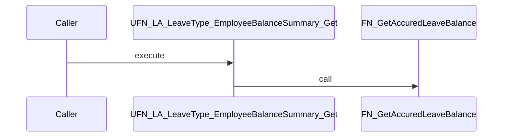
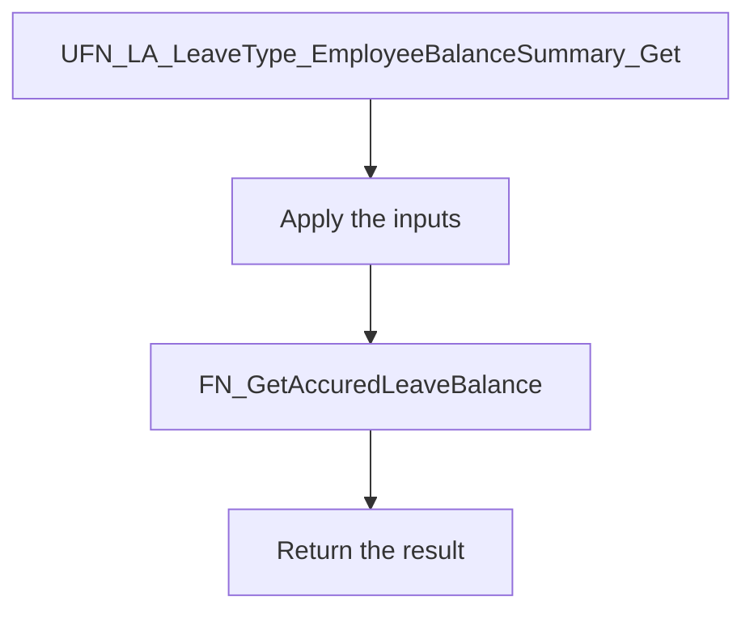

# UFN_LA_LeaveType_EmployeeBalanceSummary_Get

## What it does

Helper called by a Home dashboard procedure. It reads TEmployeeInfo, tLeaveBalance, TLeaveTypeMaster, TLeaveBalanceLedger and returns that result to its caller.

## Parameters

| Name | Direction | What it is for |
|---|---|---|
| `@EmployeeIds` | in | Input used by this procedure (`dbo.UDTT_EmployeeList`) |
| `@AsOfDate` | in | Organisation-local date the ticker is evaluated for (`DATE`) |

## Call sequence

## Callers

| Object | Kind | Page |
|---|---|---|
| `SP_GetTeamLeaveCard` | procedure | [SP_GetTeamLeaveCard](/docs/database/hrms/SP_GetTeamLeaveCard) |
| `SP_GetTeamMonthlyLeavePlan` | procedure | No page yet |
| `SP_LA_GetEmployeeLeaveDet` | procedure | [SP_LA_GetEmployeeLeaveDet](/docs/database/hrms/SP_LA_GetEmployeeLeaveDet) |
| `USP_GetEmployeeLeaveAttendanceDetails` | procedure | No page yet |

## Nested

| Object | Kind | When | Page |
|---|---|---|---|
| `FN_GetAccuredLeaveBalance` | function | Called while this object runs | No page yet |

## Steps

In `HRMS-DATABASE/HRMS/FUNCTIONS/UFN_LA_LeaveType_EmployeeBalanceSummary_Get.sql`:

1. Read through `FN_GetAccuredLeaveBalance`.
2. Read `TEmployeeInfo`, `tLeaveBalance`, `TLeaveTypeMaster`, `TLeaveBalanceLedger`, `TLeaveRequestDays`, `TLeaveEncashmentRequest`, `TEmployee`, `TLeaveBusinessUnit`, and the other tables listed below.
3. Return the result set to the caller.

## Tables

| Table | Read or write |
|---|---|
| `TEmployeeInfo` | read |
| `tLeaveBalance` | read |
| `TLeaveTypeMaster` | read |
| `TLeaveBalanceLedger` | read |
| `TLeaveRequestDays` | read |
| `TLeaveEncashmentRequest` | read |
| `TEmployee` | read |
| `TLeaveBusinessUnit` | read |
| `TLeaveGrade` | read |
| `TLeaveLocation` | read |
| `TLeaveEmployeeStatus` | read |
| `TLeaveCalendar` | read |

## Flow

