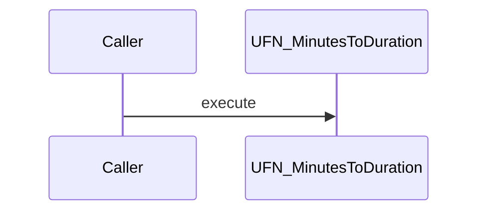
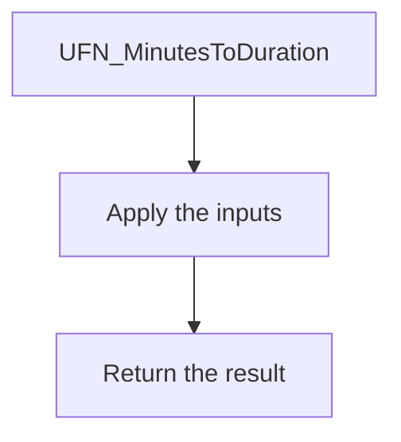

# UFN_MinutesToDuration

## What it does

Helper called by a Home dashboard procedure. It reads its inputs and returns that result to its caller.

## Parameters

| Name | Direction | What it is for |
|---|---|---|
| `@Duration` | in | Input used by this procedure (`INT`) |

## Call sequence

## Callers

| Object | Kind | Page |
|---|---|---|
| `Hrms_Sp_DailyAttendanceReport` | procedure | No page yet |
| `SP_DB_EmployeeAttendanceDetails` | procedure | [SP_DB_EmployeeAttendanceDetails](/docs/database/hrms/SP_DB_EmployeeAttendanceDetails) |
| `SP_DB_EmployeeAttendanceFromEmailDetails` | procedure | No page yet |
| `Sp_GetWhatsAppNotificationDetails` | procedure | No page yet |
| `SP_LA_GetAllNotificationToReassign` | procedure | No page yet |
| `SP_PendingCompOffRequestByEmployee` | procedure | No page yet |
| `sp_vw_AttendanceRegularizationSummaryReports` | procedure | No page yet |
| `UFN_OT_EligibleDuration` | function | No page yet |
| `UFN_RoundTime` | function | No page yet |
| `USP_AR_LinkedRequests_Get` | procedure | No page yet |
| `USP_AttendanceOverTime_Details` | procedure | No page yet |
| `USP_AttendanceOverTime_Notification_List` | procedure | No page yet |
| `USP_AttendanceOverTime_Notification_ModalView` | procedure | No page yet |
| `USP_AttendanceOverTime_Report` | procedure | No page yet |
| `USP_AttendanceOverTimeRule_History_List` | procedure | No page yet |
| `USP_ClaimCompOff_Notification_ModalView` | procedure | No page yet |
| `USP_ClaimCompOff_Report` | procedure | No page yet |
| `USP_ClaimOT_Detail_Report` | procedure | No page yet |
| `USP_ClaimOT_List` | procedure | No page yet |
| `USP_ClaimOT_Summary_Report` | procedure | No page yet |
| `USP_ClaimOT_ValidateForApprovalOrRejection` | procedure | No page yet |
| `USP_ClaimOT_ValidateRequest` | procedure | No page yet |
| `usp_ClaimOverTime` | procedure | No page yet |
| `USP_ClaimPH_AR_Link_Deactivate` | procedure | No page yet |
| `USP_ClaimPH_Employee_EligibilePH_Dates` | procedure | No page yet |
| `USP_ClaimPH_List` | procedure | No page yet |
| `USP_ClaimPH_Notification_ModalView` | procedure | No page yet |
| `USP_ClaimPH_Report` | procedure | No page yet |
| `USP_CompOff_RequestList` | procedure | No page yet |
| `USP_EmailNotificaion_ClaimPH` | procedure | No page yet |
| `USP_FreezeAttendance_ProcessPendingRequests` | procedure | No page yet |
| `USP_Get_Employees_ActualWorkedMinutesLeaves` | procedure | No page yet |
| `USP_GetEmployeeLeaveAttendanceDetails` | procedure | No page yet |
| `USP_LA_Approved_All_ClaimOT_Request` | procedure | No page yet |
| `USP_LA_Approved_All_CompOff_Request_ByEmployee` | procedure | No page yet |
| `USP_LA_Approved_All_Leave_Encashment` | procedure | No page yet |
| `USP_LA_Approved_All_PreApprovalOT_Request_Details` | procedure | No page yet |
| `USP_LA_Approved_ClaimOT_Request` | procedure | No page yet |
| `USP_LA_Employee_Attendance_CustomReport` | procedure | No page yet |
| `USP_LA_Employee_Attendance_Report` | procedure | No page yet |
| `USP_LA_EmployeeAttendanceDetails` | procedure | No page yet |
| `USP_LA_Notification_Request_Pending_ByMe_List` | procedure | No page yet |
| `USP_LA_Status_History_AttendanceOverTime` | procedure | No page yet |
| `USP_LE_EmailNotification` | procedure | No page yet |
| `USP_LE_Encashment_Notification_List` | procedure | No page yet |
| `USP_LE_List` | procedure | No page yet |
| `USP_LE_Report` | procedure | No page yet |
| `USP_LeaveRequest_Notification_ModalView` | procedure | No page yet |
| `USP_OT_AR_Link_GetForApproval` | procedure | No page yet |
| `USP_OT_Claim_DetailsPopup_Get` | procedure | No page yet |
| `USP_OT_Claim_GetAttendanceForClaim` | procedure | No page yet |
| `USP_OT_Claim_List` | procedure | No page yet |
| `USP_OT_Claim_NotificationData_Get` | procedure | No page yet |
| `USP_OT_Claim_Status_History` | procedure | No page yet |
| `USP_OT_Claim_ThresholdAlert_EmailData_Get` | procedure | No page yet |
| `USP_OT_Claim_Validate` | procedure | No page yet |
| `USP_OT_Claim_Validate_ApprovedDuration` | procedure | No page yet |
| `USP_OT_Deviation_List` | procedure | No page yet |
| `USP_OT_Deviation_Unsubmitted_List` | procedure | No page yet |
| `USP_OT_Notification_Claim_Approved_List` | procedure | No page yet |
| `USP_OT_Notification_Claim_ApprovedAll_List` | procedure | No page yet |
| `USP_OT_Notification_Claim_Pending_List` | procedure | No page yet |
| `USP_OT_Notification_Deviation_Approved_List` | procedure | No page yet |
| `USP_OT_Notification_Deviation_Pending_List` | procedure | No page yet |
| `USP_OT_Notification_List` | procedure | No page yet |
| `USP_OT_Notification_ModalView` | procedure | No page yet |
| `USP_OT_Notification_Planned_Approved_List` | procedure | No page yet |
| `USP_OT_Notification_Planned_ApprovedAll_List` | procedure | No page yet |
| `USP_OT_Notification_Planned_Pending_List` | procedure | No page yet |
| `USP_OT_OTRequest_CompletedOT` | procedure | No page yet |
| `USP_OT_OTRequest_List` | procedure | No page yet |
| `USP_OT_OTRequest_MyTeamsOT` | procedure | No page yet |
| `USP_OT_OTRequest_Notification_List` | procedure | No page yet |
| `USP_OT_OTRequest_OverTime_Report` | procedure | No page yet |
| `USP_OT_OTRequest_PreApproval_Report` | procedure | No page yet |
| `USP_OT_OTRequest_ValidateRequest` | procedure | No page yet |
| `USP_OT_Planned_CompletedOT` | procedure | No page yet |
| `USP_OT_Planned_List` | procedure | No page yet |
| `USP_OT_Planned_Reminder_EmailData_Get` | procedure | No page yet |
| `USP_OT_Planned_Status_History` | procedure | No page yet |
| `USP_OT_Planned_UpcomingOT` | procedure | No page yet |
| `USP_OT_Planned_Validate` | procedure | No page yet |
| `USP_OT_Planned_Validate_ApprovedDuration` | procedure | No page yet |
| `USP_OT_Popup_Claim_Details_Get` | procedure | No page yet |
| `USP_OT_Popup_ShiftAndRuleDetails_Get` | procedure | No page yet |
| `USP_OT_PreApproved_DayWise_Report` | procedure | No page yet |
| `USP_OT_Report_AttendanceCardText_Get` | procedure | No page yet |
| `USP_OT_SendThresholdAlertEmail` | procedure | No page yet |
| `USP_OT_Tooltip_AttendanceCardText_Get` | procedure | [USP_OT_Tooltip_AttendanceCardText_Get](/docs/database/hrms/USP_OT_Tooltip_AttendanceCardText_Get) |
| `USP_Payroll_LeaveOT_Information` | procedure | No page yet |
| `USP_Reassign_GetCandidateEligibilityDetail` | procedure | No page yet |
| `USP_Reassign_List` | procedure | No page yet |
| `USP_Report_Leave_LeaveEncashmment` | procedure | No page yet |
| `USP_Report_TimeAttendance_Overtime_DayWise` | procedure | No page yet |
| `USP_Report_TimeAttendance_OverTime_Detail` | procedure | No page yet |
| `USP_Report_TimeAttendance_Overtime_Planned` | procedure | No page yet |
| `USP_Report_TimeAttendance_OverTime_Summary` | procedure | No page yet |
| `usp_UVW_AttendanceOverTime` | procedure | No page yet |
| `usp_UVW_OT_OTRequest_PreApproval_Report` | procedure | No page yet |
| `usp_vw_CompOffRequestEmailData` | procedure | No page yet |

## Nested

This object does not execute another procedure or user-defined function.

## Steps

In `HRMS-DATABASE/HRMS/FUNCTIONS/UFN_MinutesToDuration.sql`:

1. Return the result set to the caller.

## Tables

No permanent table is read or written. The result comes from parameters, functions, or table variables.

## Flow

