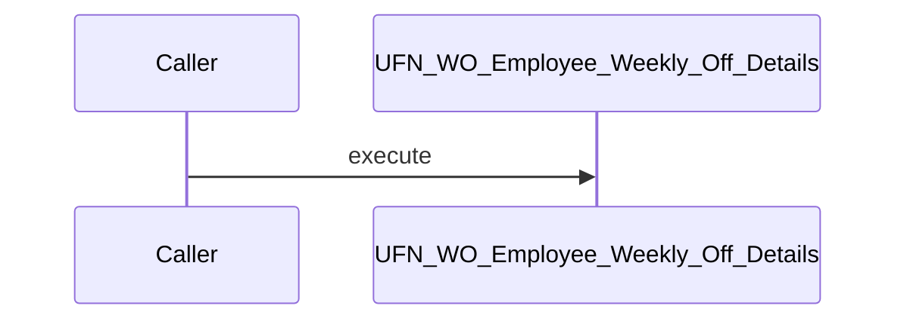
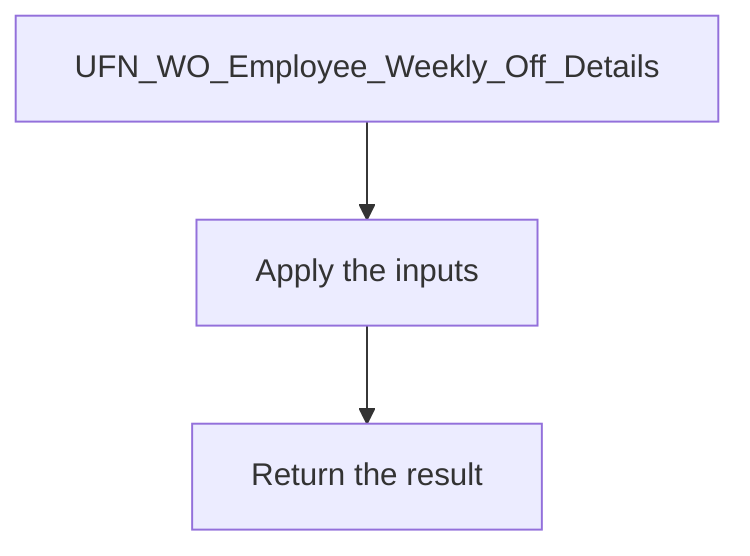

# UFN_WO_Employee_Weekly_Off_Details

## What it does

Helper called by a Home dashboard procedure. It reads and writes GD, ED, TCalenderDays, TDailyRegisterNew and returns that result to its caller.

## Parameters

| Name | Direction | What it is for |
|---|---|---|
| `@EmployeeID` | in | Employee the Home screen is loading or acting for (`INT`) |
| `@EmployerID` | in | Employer that owns the data (`INT`) |
| `@StartDate` | in | Range start (`DATE`) |
| `@EndDate` | in | Range end (`DATE`) |
| `@CalculationDates` | in | Input used by this procedure (`VARCHAR(MAX)`) |

## Call sequence

## Callers

| Object | Kind | Page |
|---|---|---|
| `FN_CM_GetEmployeeCalendarDetails_AttendanceCal` | function | No page yet |
| `Fn_GetEndOfNoticePeriodDate` | function | No page yet |
| `FN_GetWeeklyOffandHolidayCnt` | function | No page yet |
| `FN_TS_NoOfDaysCnt` | function | No page yet |
| `FN_WeeklyOff_DateRange` | function | No page yet |
| `SP_AttendanceSummary_Employerwise` | procedure | No page yet |
| `SP_DB_EmployeeAttendanceDetails` | procedure | [SP_DB_EmployeeAttendanceDetails](/docs/database/hrms/SP_DB_EmployeeAttendanceDetails) |
| `SP_DB_EmployeeAttendanceFromEmailDetails` | procedure | No page yet |
| `SP_DB_EmployeeDayWiseAttendanceDetails` | procedure | No page yet |
| `SP_GetActualOfficeWorkingTimePerEmployee` | procedure | No page yet |
| `SP_GetARWFHEndDate` | procedure | No page yet |
| `SP_GetAttendaceReport_GUIBase` | procedure | No page yet |
| `SP_GETCHECKINOUTTIME` | procedure | No page yet |
| `SP_GetEmployeeWeeklyOffDays` | procedure | No page yet |
| `Sp_GetWeeklyOffandHolidayFlagForDate` | procedure | No page yet |
| `sp_InsertARWHDays` | procedure | No page yet |
| `SP_LA_Hourly_LeaveDropDown` | procedure | No page yet |
| `SP_LA_Validate_HourlyBasedLeave` | procedure | No page yet |
| `SP_LA_ValidateDayBasedARRequest` | procedure | No page yet |
| `SP_LA_ValidateOptionalHolidayRequest` | procedure | No page yet |
| `SP_LeaveAttendanceGetAttendanceSourceAnalysis_Chart_Compact` | procedure | No page yet |
| `SP_LeaveAttendanceGetAttendanceSourceAnalysisChartDrillDown_Compact` | procedure | No page yet |
| `SP_LeaveAttendanceGetLeaveTrendAnalysis_Compact` | procedure | No page yet |
| `SP_LeaveAttendanceGetLeaveTrendAnalysis_DrillDown_Compact` | procedure | No page yet |
| `SP_LeaveAttendanceGetLeaveUtilizedByType_Compact` | procedure | No page yet |
| `SP_LeaveAttendanceGetLeaveUtilizedByType_DrillDown_Compact` | procedure | No page yet |
| `SP_LeaveAttendanceGetLiveAttendanceSummaryChart_Compact` | procedure | No page yet |
| `SP_LeaveAttendanceGetLiveAttendanceSummaryChart_DrillDown_Compact` | procedure | No page yet |
| `SP_LeaveAttendanceGetOTSummaryChart_Compact` | procedure | No page yet |
| `SP_LeaveAttendanceGetOTSummaryChartDrillDown_Compact` | procedure | No page yet |
| `SP_LeaveAttendanceGetPendingLeaveRequests` | procedure | No page yet |
| `SP_LeaveAttendanceGetTeamAvailabilityCalendar_Compact` | procedure | No page yet |
| `SP_LeaveAttendanceGetTeamAvailabilityCalendarDrillDown_Compact` | procedure | No page yet |
| `SP_NoOfDaysCnt` | procedure | No page yet |
| `Sp_SEP_CheckIfDateIsWeeklyOfOrHoliday` | procedure | No page yet |
| `Sp_SEP_ValidateActivityDate` | procedure | No page yet |
| `SP_ValidateRequest` | procedure | No page yet |
| `UFN_CM_GetEmployeeCalendarDetails_ApplyLeave` | function | No page yet |
| `UFN_Get_Employee_CalenderorWorking_Eligible_Dates` | function | No page yet |
| `UFN_LA_Intervening_Chain_Length` | function | No page yet |
| `UFN_LA_WorkingDaysCount` | function | No page yet |
| `USP_ApplyOnDuty` | procedure | No page yet |
| `USP_FNF_GetEmployee_Payable_Days` | procedure | No page yet |
| `USP_GetAttendanceForPayroll` | procedure | No page yet |
| `USP_GetEmployeeLeaveAttendanceDetails` | procedure | No page yet |
| `USP_LA_AR_DayDropDown_DateRange` | procedure | No page yet |
| `USP_LA_LeaveDayDropDown_DateRange` | procedure | No page yet |
| `USP_LA_Validate_Leave_FromToDate` | procedure | No page yet |
| `USP_LA_Validate_Leave_Intervening_Date` | procedure | No page yet |
| `USP_LA_ValidateLeaveRequest` | procedure | No page yet |
| `USP_OH_ValidateRequest` | procedure | No page yet |
| `USP_TAttendanceRegularization_Validate` | procedure | No page yet |

## Nested

This object does not execute another procedure or user-defined function.

## Steps

In `HRMS-DATABASE/HRMS/FUNCTIONS/UFN_WO_Employee_Weekly_Off_Details.sql`:

1. Write `GD`, `ED`.
2. Read `TCalenderDays`, `TDailyRegisterNew`, `TEmployeeInfo`, `TWeeklyOffMaster`, `TEmployeeDayWiseAttendanceStatus`.
3. Return the result set to the caller.

## Tables

| Table | Read or write |
|---|---|
| `GD` | write |
| `ED` | write |
| `TCalenderDays` | read |
| `TDailyRegisterNew` | read |
| `TEmployeeInfo` | read |
| `TWeeklyOffMaster` | read |
| `TEmployeeDayWiseAttendanceStatus` | read |

## Flow

