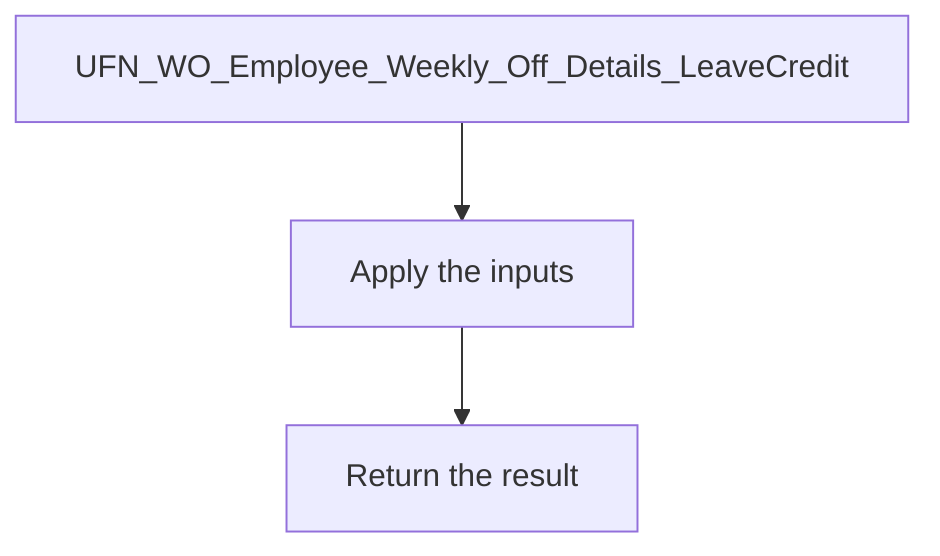

# UFN_WO_Employee_Weekly_Off_Details_LeaveCredit

## What it does

Table-valued function returning weekly-off day details used in leave-credit pro-rata denominators.

## Parameters

| Name | Direction | What it is for |
|---|---|---|
| `@CalculationDates` | in | `VARCHAR(MAX)` |
| `@EmployeeID` | in | `INT` |
| `@EmployerID` | in | `INT` |
| `@StartDate` | in | `DATE` |
| `@EndDate` | in | `DATE` |

## Call sequence

Calls no other procedures or functions.

## Callers

| Object | Kind | Page |
|---|---|---|
| `SP_CatchUpLeaveCredit_ForEmployee` | procedure | No page yet |
| `SP_LeaveCreditDOJ` | procedure | No page yet |
| `SP_MonthlyLeaveCredit` | procedure | [SP_MonthlyLeaveCredit](/docs/database/hrms/SP_MonthlyLeaveCredit) |
| `SP_MonthlyLeaveCreditPreview` | procedure | No page yet |
| `SP_QHYLeaveCredit` | procedure | [SP_QHYLeaveCredit](/docs/database/hrms/SP_QHYLeaveCredit) |
| `SP_Separation_EndOfMonth_MonthlyLeaveCredit` | procedure | No page yet |
| `SP_Separation_QHYEndOfMonth` | procedure | No page yet |
| `SP_Separation_QHYStartOfMonth` | procedure | No page yet |
| `SP_Separation_StartOfMonth_MonthlyLeave` | procedure | No page yet |

## Nested

Calls no other procedures or functions.

## Steps

In `HRMS-DATABASE/HRMS/FUNCTIONS/UFN_WO_Employee_Weekly_Off_Details_LeaveCredit.sql`:
1. Accept the declared parameters and run the procedure or function body.
3. Read or write the tables listed under Tables.
4. Return result sets, scalar values, or status as defined in the script.

## Tables

| Table | Read or write |
|---|---|
| `TCalenderDays` | read or write |
| `TDailyRegisterNew` | read or write |
| `TEmployeeDayWiseAttendanceStatus` | read or write |
| `tEmployeeInfo` | read or write |
| `TEmployeeInfo` | read or write |
| `TWeeklyOffMaster` | read or write |

## Flow

