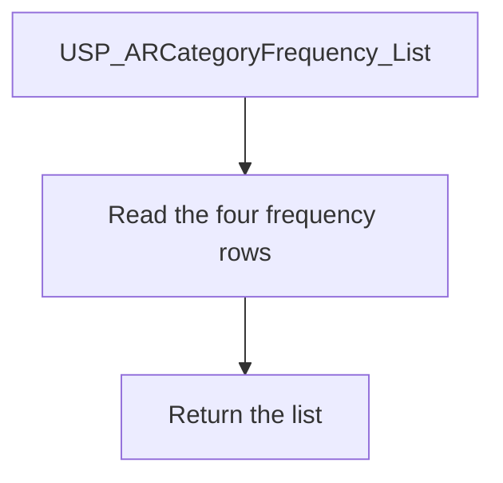

# USP_ARCategoryFrequency_List

## What it does

Returns the frequency choices an attendance-regularization category may use: Weekly, Monthly, Yearly, and Payroll Cut-Off cycle.

## Parameters

This procedure takes no parameters.

## Call sequence

Calls no other procedures or functions.

## Callers

No other procedure or function calls this object. `AttendanceManagementDAL.GetAttendanceCategoryFrequency` calls it from Attendance Management.

## Nested

Calls no other procedures or functions.

## Steps

1. Select `ARCategoryFrequenceID`, `ARCategoryFrequence`, and `FrequenceCode` from `ARCategoryFrequence`.
2. Keep only Weekly, Monthly, Yearly, and Payroll Cut-Off cycle.

## Tables

| Table | Read or write |
|---|---|
| `ARCategoryFrequence` | read |

## Flow

