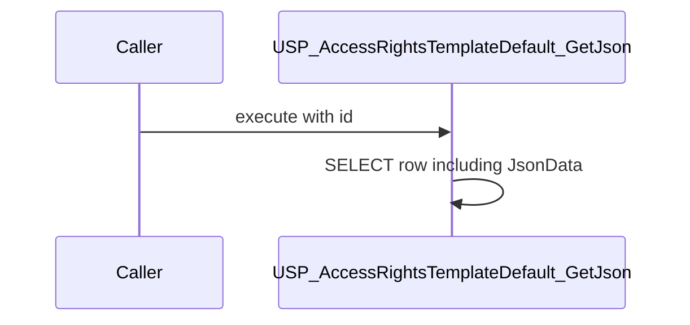
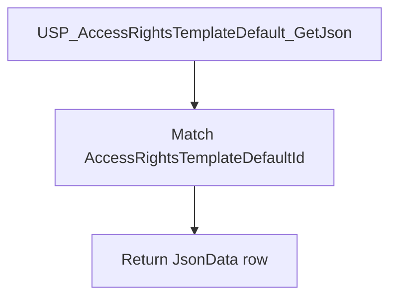

# USP_AccessRightsTemplateDefault_GetJson

## What it does

Returns one default access-rights template row by primary key, including its `JsonData` payload. Used by Default Access Right Management when the operator opens a specific historical version.

## Parameters

| Name | Direction | What it is for |
|---|---|---|
| `@AccessRightsTemplateDefaultId` | in | Template row id to load |

## Call sequence

Calls no other procedures or functions.

## Callers

Procedures and functions that call this object.

No other procedure or function calls this object. Application caller: Core Node `AccessRightsManagementDAL.getAccessRightsTemplateDefaultJson` via `GET /api/accessRightsManagement/defaultTemplate/:accessRightsTemplateDefaultId/json`.

## Nested

Calls no other procedures or functions.

## Steps

1. `SET NOCOUNT ON`.

2. Select `AccessRightsTemplateDefaultId`, `Version`, `IsActive`, `JsonData` from `TAccessRightsTemplateDefault` where the id matches `@AccessRightsTemplateDefaultId`.

## Tables

| Table | Read or write |
|---|---|
| `TAccessRightsTemplateDefault` | read |

## Unresolved calls

None.

## Flow

