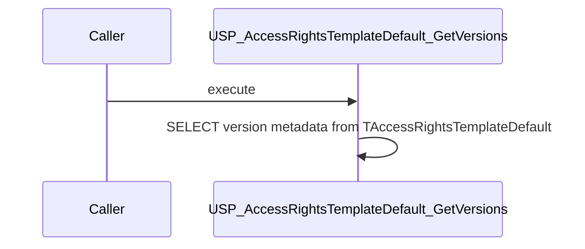
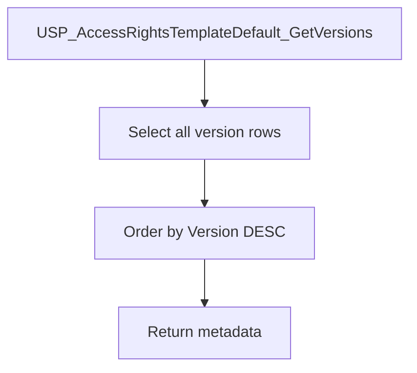

# USP_AccessRightsTemplateDefault_GetVersions

## What it does

Returns version metadata for every row in `TAccessRightsTemplateDefault`, newest version first. Used by Default Access Right Management when listing historical default template versions (without loading `JsonData`).

## Parameters

None.

## Call sequence

Calls no other procedures or functions.

## Callers

Procedures and functions that call this object.

No other procedure or function calls this object. Application caller: Core Node `AccessRightsManagementDAL.getAccessRightsTemplateDefaultVersions` via `GET /api/accessRightsManagement/defaultTemplate/versions`.

## Nested

Calls no other procedures or functions.

## Steps

1. `SET NOCOUNT ON`.

2. Select `AccessRightsTemplateDefaultId`, `Version`, `CreatedBy`, `CreatedDate`, `ModifiedBy`, `ModifiedDate`, `IsActive` from `TAccessRightsTemplateDefault`.

3. Order by `Version DESC`, then `AccessRightsTemplateDefaultId DESC`.

## Tables

| Table | Read or write |
|---|---|
| `TAccessRightsTemplateDefault` | read |

## Unresolved calls

None.

## Flow

