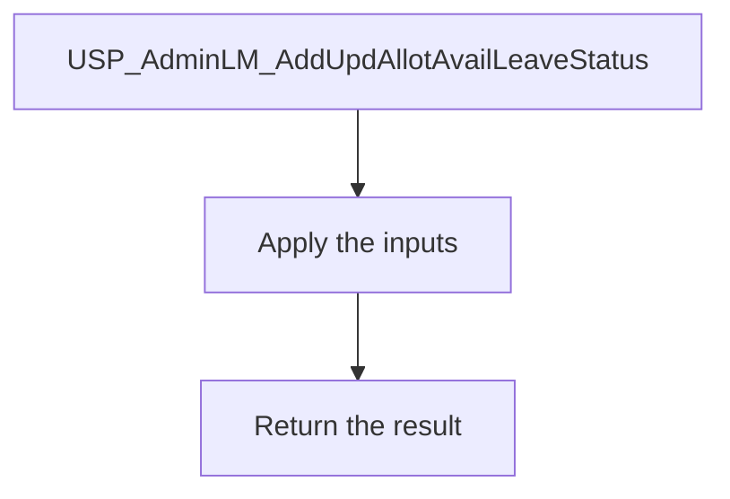

# USP_AdminLM_AddUpdAllotAvailLeaveStatus

## What it does

Upserts allot/avail employee status mappings for a leave type (legacy AdminLM path).

## Parameters

No parameters were parsed from the script signature.

## Call sequence

Calls no other procedures or functions.

## Callers

| Object | Kind | Page |
|---|---|---|
| `SP_AdminLM_UpdNewLeaveType` | procedure | [SP_AdminLM_UpdNewLeaveType](/docs/database/hrms/SP_AdminLM_UpdNewLeaveType) |
| `USP_AdminLM_UpdNewLeaveType` | procedure | No page yet |

## Nested

Calls no other procedures or functions.

## Steps

In `HRMS-DATABASE/HRMS/STOREPROCEDURE/USP_AdminLM_AddUpdAllotAvailLeaveStatus.sql`:
1. Accept the declared parameters and run the procedure or function body.
4. Return result sets, scalar values, or status as defined in the script.

## Tables

No `T*` tables were matched in a simple FROM/JOIN/INSERT/UPDATE/DELETE scan.

## Flow

