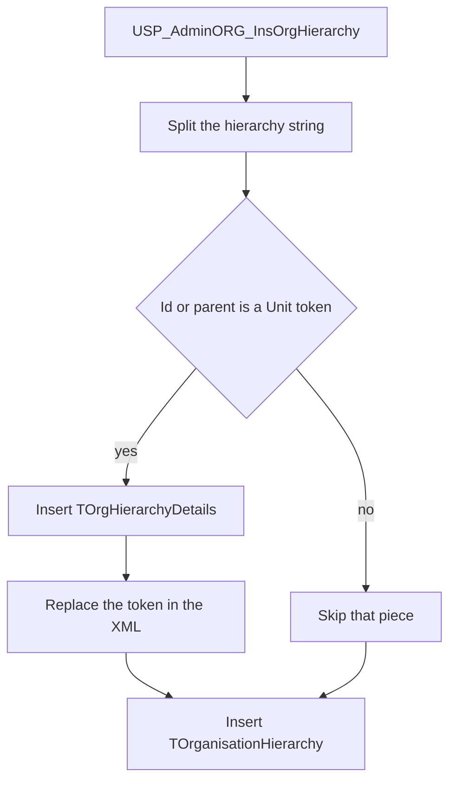

# USP_AdminORG_InsOrgHierarchy

## What it does

Inserts a first organisation tree for one employer. It turns each new `<Unit…>` token in the hierarchy string into a `TOrgHierarchyDetails` row, replaces those tokens in the chart XML with the new identity values, and stores the XML on `TOrganisationHierarchy`. The header says work item 73302 changed the save to use the identity value. There is no check for an existing chart for the employer, and no transaction.

## Parameters

| Name | Direction | What it is for |
|---|---|---|
| `@OrgXML` | in | Telerik tree XML. `<` and `>` entities are decoded before it is stored |
| `@OrgHierarchy` | in | Pipe-separated units. Each piece is `id~name~parentId~Y or N` |
| `@CreatedBy` | in | Employee stored on the new unit rows and on the chart row |
| `@Employerid` | in | Employer the units and the chart belong to |

## Call sequence

Calls no other procedures or functions.

## Callers

No other procedure or function calls this object. Create Organization Structure calls it through `EmployerDal.SaveOrganizationStructure` when the button text is Save.

## Nested

Calls no other procedures or functions.

## Steps

In `HRMS-DATABASE/HRMS/STOREPROCEDURE/USP_AdminORG_InsOrgHierarchy.sql`:

1. Set `NOCOUNT ON` and `READ UNCOMMITTED`.
2. Replace `&lt;` and `&gt;` in `@OrgXML`.
3. Split `@OrgHierarchy` on `|` into `#OrgHierarchy`, numbered in split order.
4. For each piece, read id, name, parent, and the active flag. When the id or the parent contains `<Unit`, insert that piece into `#NewlyCreatedBUs`. Pieces that are already numeric are not written.
5. Copy those rows into `#NewBUs` with a row number ordered by `TextVersionUnitId` as text.
6. For each new unit, if the parent still contains `<Unit`, replace it with the `UnitId` already assigned to that token in `#NewBUs`.
7. Insert `TOrgHierarchyDetails` (`UnitName`, `ParentUnitid`, `Employerid`, default `isactive` and `isdelete`, `CreatedBy`, `CreatedWhen`). Keep `@@IDENTITY`.
8. Replace that `<Unit…>` token in `@OrgXML` with the identity, and store the identity on `#NewBUs`.
9. Insert one `TOrganisationHierarchy` row with the rewritten XML, `@CreatedBy`, `GETDATE()`, and `@Employerid`.

## Tables

| Table | Read or write |
|---|---|
| `#OrgHierarchy` | write |
| `#NewlyCreatedBUs` | write |
| `#NewBUs` | read and write |
| `dbo.TOrgHierarchyDetails` | write |
| `dbo.TOrganisationHierarchy` | write |

## Flow

