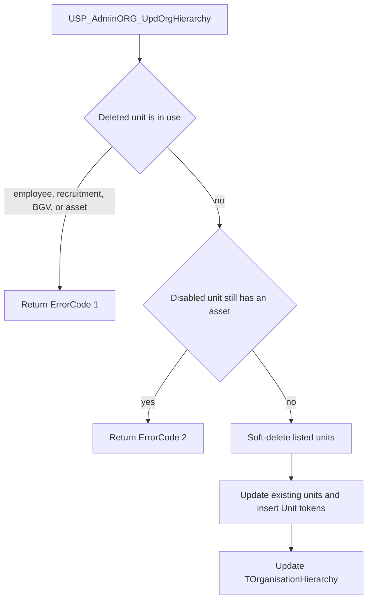

# USP_AdminORG_UpdOrgHierarchy

## What it does

Updates an existing organisation chart. It refuses a delete when the unit is on an employee, a recruitment requisition, a background-verification request, or an allocated asset, and it refuses a disable when an asset is still allocated. Otherwise it soft-deletes the listed units, updates existing units, inserts units that still use a `<Unit…>` token, and writes the rewritten XML back to `TOrganisationHierarchy`. It does not insert a history row. The script uses `READ UNCOMMITTED` and has no transaction.

## Parameters

| Name | Direction | What it is for |
|---|---|---|
| `@Transid` | in | `TOrganisationHierarchy` row to update |
| `@OrgXML` | in | Telerik tree XML. `<` and `>` entities are decoded before it is stored |
| `@OrgHierarchy` | in | Pipe-separated units. Each piece is `id~name~parentId~Y or N` |
| `@Employeeid` | in | Employee stored in `UpadtedBy` or `CreatedBy` |
| `@EmployerId` | in | Employer used for the in-use checks and for new units |
| `@DeletedBUNodes` | in | Pipe-separated unit ids the admin removed |
| `@DisabledBUNodes` | in | Pipe-separated unit ids the admin disabled. Default null. Used only for the asset check |

## Call sequence

Calls no other procedures or functions.

## Callers

No other procedure or function calls this object. Create Organization Structure calls it through `EmployerDal.UpdateOrganizationStructure` when the button text is Update.

## Nested

Calls no other procedures or functions.

## Steps

In `HRMS-DATABASE/HRMS/STOREPROCEDURE/USP_AdminORG_UpdOrgHierarchy.sql`:

1. Set `NOCOUNT ON` and `READ UNCOMMITTED`. Decode `&lt;` and `&gt;` in `@OrgXML`.
2. When `@DisabledBUNodes` is not empty, store the names of those units that still have a row in `tBusinessUnitAssets` with `IsDeactivated = 0`. The return for that list happens later.
3. When `@DeletedBUNodes` is not empty, build the same kind of name list for allocated assets and keep it as a message suffix.
4. When any of those deleted units is `TEmployeeInfo.BusinessUnitId` for the employer, return `ErrorCode` 1 with the employee-module message and stop.
5. When any deleted unit is `TRRSDetails.BusinessUnitId`, return `ErrorCode` 1 for recruitment and stop.
6. When any deleted unit is `TBGVVerificationRequest.BusinessUnitId`, return `ErrorCode` 1 for background verification and stop.
7. When the deleted-unit asset list is not null, return `ErrorCode` 1 with the asset message and stop.
8. When the disabled-unit asset list from step 2 is not null, return `ErrorMsg` and `ErrorCode` 2 and stop.
9. Set `isdelete = 'Y'`, `isactive = 'N'`, `UpadtedBy`, and `UpdatedWhen` on `TOrgHierarchyDetails` for the deleted ids and this employer.
10. Split `@OrgHierarchy` on `|`. For each piece, if the id or parent contains `<Unit`, stage it in `#NewlyCreatedBUs`. Otherwise update that `UnitID`'s name, `isactive`, `ParentUnitid`, `UpadtedBy`, and `UpdatedWhen`.
11. Number the staged rows by `UnitName`. For each one, resolve a `<Unit` parent from `#NewBUs` when that parent already has an identity.
12. Insert `TOrgHierarchyDetails`, replace the token in `@OrgXML` with `@@IDENTITY`, and store the identity on `#NewBUs`.
13. Update `TOrganisationHierarchy` for `@Transid` with the rewritten XML, `Lastupdateby`, and `Lastupdatedate`. No result set is selected on this path.

## Tables

| Table | Read or write |
|---|---|
| `dbo.tBusinessUnitAssets` | read |
| `dbo.TOrgHierarchyDetails` | read and write |
| `dbo.TEmployeeInfo` | read |
| `dbo.TRRSDetails` | read |
| `dbo.TBGVVerificationRequest` | read |
| `#OrgHierarchy` | write |
| `#NewlyCreatedBUs` | write |
| `#NewBUs` | read and write |
| `dbo.TOrganisationHierarchy` | write |

## Flow

