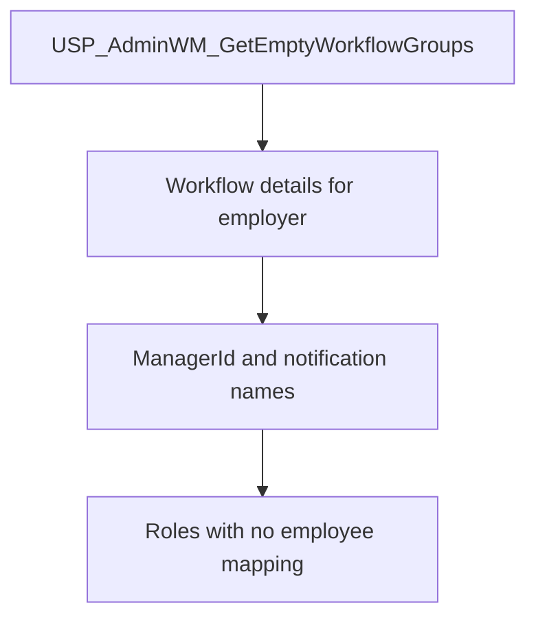

# USP_AdminWM_GetEmptyWorkflowGroups

## What it does

Returns non-default workflow groups (`TRoleManagement`) for an employer that are referenced by that employer's live workflow details (as `ManagerId` or as a name inside notification CSV columns) but have **no** rows in `tRoleEmployeeMapping`. Workflow Dashboard shows these as an empty-group warning.

The script begins with `USE [HRM-CL-Prod]`.

## Parameters

| Name | Direction | What it is for |
|---|---|---|
| `@EmployerId` | in | Organisation whose workflows and roles are scanned |

## Call sequence

Calls no other procedures or functions.

## Callers

No other procedure or function calls this object.

`WorkflowDAL.GetEmptyWorkflowGroups` executes it from `GET /api/workflow/GetEmptyWorkflowGroups`.

## Nested

Calls no other procedures or functions.

## Steps

1. Collect live `TWorkflowDetails` for non-deleted `TWorkflowManagement` rows that map to `TModulePages` for `@EmployerId`.
2. Collect distinct `ManagerId` values as role ids.
3. Split notification CSV columns and match `TRoleManagement.RoleName` for the same employer.
4. Union those role ids and return roles that are not deleted, not default (`IsDefault = 'N'`), and have no `tRoleEmployeeMapping` rows. Order by `RoleName`.

## Tables

| Table | Read or write |
|---|---|
| `TModulePages` | read |
| `TWorkflowManagement` | read |
| `TWorkflowDetails` | read |
| `TRoleManagement` | read |
| `tRoleEmployeeMapping` | read |

## Unresolved calls

None.

## Flow

