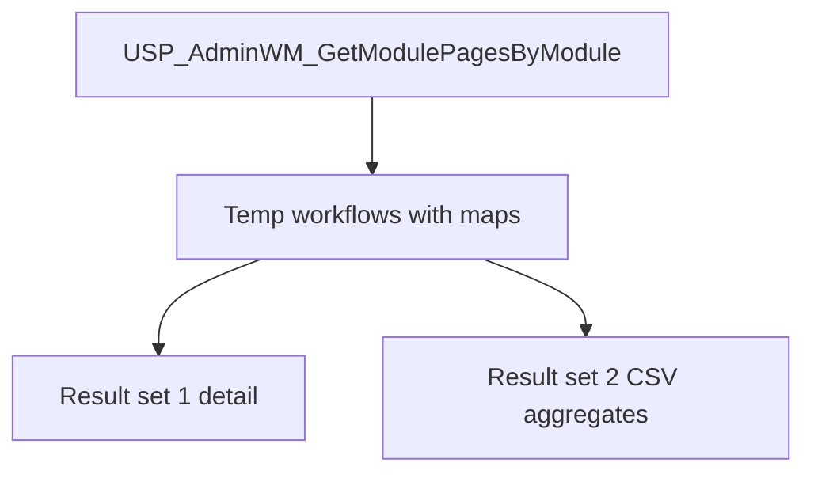

# USP_AdminWM_GetModulePagesByModule

## What it does

Lists workflows for an employer (optionally filtered by module and mapped page) with each workflow's location and business-unit ids, then returns a second result set with the aggregated location and BU id CSVs across those rows. The Add Workflow page reads **Tables[1]** (the aggregated CSV set) via `GetModulePageBUAndLocations`.

## Parameters

| Name | Direction | What it is for |
|---|---|---|
| `@ModuleId` | in | Optional module filter |
| `@MappedAppPage` | in | Optional mapped page id filter |
| `@EmployerId` | in | Tenant |

## Call sequence

Calls no other procedures or functions.

## Callers

No other procedure or function calls this object. Application caller: `WorkflowManagementDAL.GetModulePageBUAndLocations`.

## Nested

Calls no other procedures or functions.

## Steps

1. Build `#DP_WorkflowManagement` from `TWorkflowManagement` expanded by `MappedPages`, left-joined to location and BU maps (`USP_AdminWM_GetModulePagesByModule.sql`).
2. Select all rows from that temp table (result set 1).
3. Aggregate distinct location and BU ids into CSV variables.
4. Select those CSVs as result set 2.

## Tables

| Table | Read or write |
|---|---|
| `TWorkflowManagement` | read |
| `TWorkFlowLocations` | read |
| `TWorkFlowBusinessUnits` | read |

## Flow

