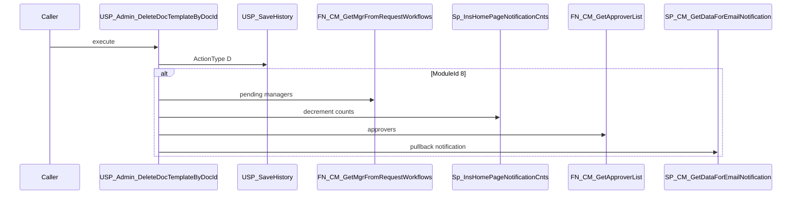
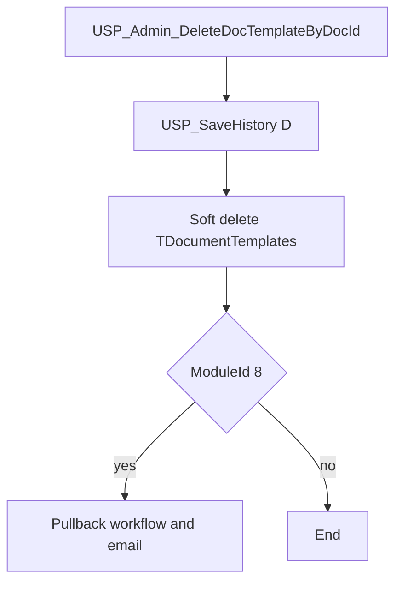

# USP_Admin_DeleteDocTemplateByDocId

## What it does

Soft-deletes a document template (`Isdeleted = 1`, `Status = Pullback`) after writing a history snapshot. When the template's `ModuleId` is 8, it also adjusts homepage notification counts, marks pending `TRequestWorkflows` as pullback (`B`), and queues an email notification for `DocumentBuilderRecruitment`.

## Parameters

| Name | Direction | What it is for |
|---|---|---|
| `@documentid` | in | Template to delete |
| `@Employerid` | in | Employer for notification and workflow lookup |
| `@EmployeeId` | in | Actor for history and updates |

## Call sequence

## Callers

No other procedure or function calls this object. `DocBuilderDAL.DeleteAdminDocTemplates` executes it from Doc Builder.

## Nested

| Object | Kind | When | Page |
|---|---|---|---|
| `USP_SaveHistory` | procedure | before soft delete | No page yet (source not in HRMS STOREPROCEDURE inventory) |
| `FN_CM_GetMgrFromRequestWorkflows` | function | ModuleId 8 branch | [FN_CM_GetMgrFromRequestWorkflows](/docs/database/hrms/FN_CM_GetMgrFromRequestWorkflows) |
| `Sp_InsHomePageNotificationCnts` | procedure | ModuleId 8 branch | [Sp_InsHomePageNotificationCnts](/docs/database/hrms/Sp_InsHomePageNotificationCnts) |
| `FN_CM_GetApproverList` | function | ModuleId 8 branch | [FN_CM_GetApproverList](/docs/database/hrms/FN_CM_GetApproverList) |
| `SP_CM_GetDataForEmailNotification` | procedure | ModuleId 8 branch | [SP_CM_GetDataForEmailNotification](/docs/database/hrms/SP_CM_GetDataForEmailNotification) |

## Steps

1. Read `ModuleId` for `@documentid`.
2. Call `USP_SaveHistory` with action `D`.
3. Soft-delete the `TDocumentTemplates` row.
4. When `ModuleId` is 8, decrement homepage counts, pull back pending request workflows, resolve the DocumentBuilderRecruitment workflow, and insert a notification row.

## Tables

| Table | Read or write |
|---|---|
| `dbo.TDocumentTemplates` | read, write |
| `dbo.TDocumentTemplates_History` | write via `USP_SaveHistory` |
| `dbo.TRequestWorkflows` | write |
| `dbo.TWorkflowManagement` | read |
| `dbo.TModulePages` | read |
| `dbo.TEmailNotification` | write |

## Unresolved calls

`USP_SaveHistory` create script was not found under `HRMS-DATABASE/HRMS/STOREPROCEDURE/`. `@Lv_HomePagaNotificationId` and `@lv_TransId` are declared but not assigned before the ModuleId 8 notification call.

## Flow

